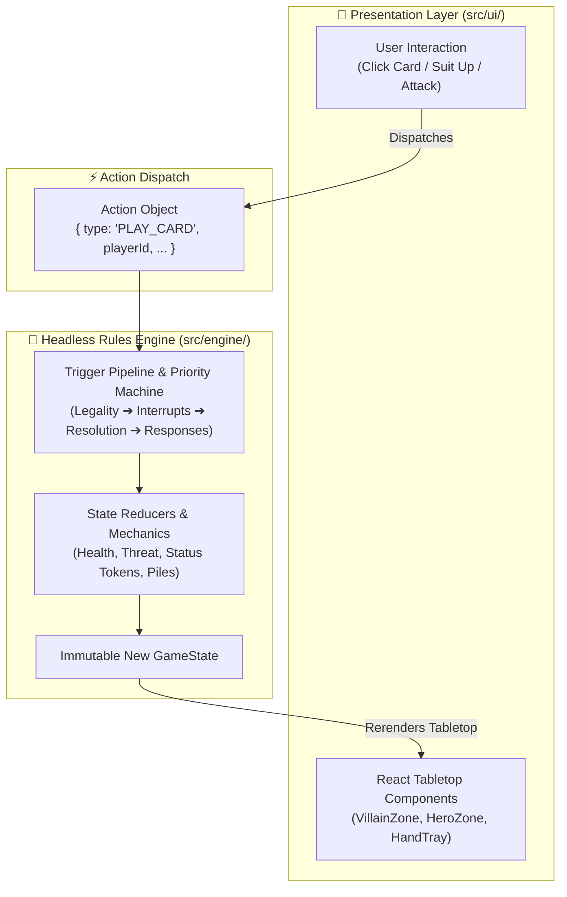

# Marvel Champions Digital (MCD)

[](https://github.com/SteveRodrigue/MCD/actions)
[](LICENSE)
[](https://www.typescriptlang.org/)
[](https://react.dev/)
[](https://vite.dev/)
[](https://tailwindcss.com/)

An open-source, faithful digital adaptation of **Marvel Champions: The Card Game** (by Fantasy Flight Games), featuring a **deterministic headless rules engine** and a **1960s Silver-Age Comic / Pop-Art aesthetic** (inspired by vintage Marvel comic panels and Batman '66).

---

## 🌟 Key Features

- **Headless & Deterministic Rules Engine:** 100% test-driven core engine decoupled from rendering, ensuring accurate execution of complex timing triggers, interrupts, forced responses, and replacement effects.

- **60s Comic Pop-Art Aesthetic:** Ben-Day halftone dot patterns, comic book panel playmats, speech bubbles, dynamic boundary-aware hover-zoom, and punchy onomatopoeia overlays (_POW!_, _BAM!_, _KAPOW!_, _THWIP!_).

- **Data-Driven, Pack-Based Content:** Everything the game plays is loaded at runtime from **packs** in [`content/`](content/README.md) (cards, declarative rules data, scenarios). The Core Set is a pack, and so is yours. Card metadata is synced from [`zzorba/marvelsdb-json-data`](https://github.com/zzorba/marvelsdb-json-data) with `npm run content:sync`. With no packs enabled the game opens an empty-shell welcome screen.

- **Create Your Own Content:** Add heroes, villains and scenarios as JSON-only packs, edit rules data in the in-browser supplemental editor, and swap card art with optional art packs. Start with the **[Creator Guide](docs/creators/README.md)**.

- **No Official Art or PDFs Shipped:** Card images are fetched on demand from [MarvelCDB](https://marvelcdb.com) into a git-ignored local cache (`content/.cache/`). The official rulebook PDFs are not tracked either (see [`references/SETUP.md`](references/SETUP.md)).

- **Developer Tooling & Inspectors:** Integrated Dev Mode with search, scrying, and multi-tier sorting for Player and Encounter decks.

- **Platform:** Runs in modern web browsers via the Vite dev server. A native desktop build via **Tauri** is parked ([#548](https://github.com/SteveRodrigue/MCD/issues/548)); so are browser-side pack import and zip install.

---

## 🏗️ Architecture & Dataflow



- **[Architecture Decision Records (ADRs)](docs/decisions/README.md)** — Comprehensive centralized registry of all architectural, technical, and gameplay design decisions (ADR-0001 onward).
- **[Algorithmic Rules Reference](docs/engine/algorithmic_rules_reference.md)** — Precise mathematical state machine and timing pipeline specifications derived from RR v1.8.
- **[Project Roadmap & Milestones](docs/roadmap_and_milestones.md)** — Detailed 5-phase iterative development plan and status.
- **[Content Packs](content/README.md)** and **[Creator Guide](docs/creators/README.md)** — Pack layout, `pack.json` format, scenarios, the editor and art packs ([ADR-0092](docs/decisions/0092-content-packs-and-runtime-loading.md)).
- **[Supplemental Specification Suite](docs/creators/supplemental-reference/README.md)** — The declarative card-data contract and its validation ([tooling notes](docs/engine/tools/supplemental_schema_validation.md)).
- **[Coding Guidelines & Standards](docs/engine/coding_guidelines.md)** — Strict architectural boundaries, typing rules, UI layering standards, and TDD requirements.
- **[Contributing: Setup & Commands](CONTRIBUTING.md#-setup--commands)** — Environment setup, Windows PATH and credential troubleshooting, and the command table.
- **[Changelog](CHANGELOG.md)** — Chronological release history and milestone log. Pending changes are tracked in `changes/unreleased/` and compiled with `npm run changelog:release -- <version>` (see [changes/README.md](changes/README.md)).

---

## 🚀 Getting Started

### Prerequisites

- **Node.js:** v18.0.0 or higher (CI runs Node 22)
- **npm:** v9.0.0 or higher

> [!TIP]
> For detailed platform-specific installation steps, PATH troubleshooting, and execution policy setup, consult **[Contributing: Setup & Commands](CONTRIBUTING.md#-setup--commands)**.

### Installation

```bash
# Clone the repository
git clone https://github.com/SteveRodrigue/MCD.git
cd MCD

# Install dependencies
npm install
```

### Development

```bash
# Start local Vite development server with Hot Module Replacement (HMR)
npm run dev
# Open http://localhost:3000/ in your browser
```

The Core pack is enabled by default (`content/config.json`). Card art is downloaded from MarvelCDB the first time a card is shown; to fill the cache ahead of time run `npm run cache:cards`. Pull fresh upstream card data with `npm run content:sync`, and check packs with `npm run pack:validate -- content/packs`.

### Running Tests

```bash
# Run unit tests via Vitest
npm test

# Run tests in interactive watch mode
npm run test:watch

# Run test coverage report
npm run test:coverage
```

### Type Checking & Linting

```bash
npm run typecheck
npm run lint
npm run verify   # format, lint, typecheck, tests, coverage, build
```

---

## 📁 Project Structure

```
MCD/
├── .github/              # CI workflows, Issue & PR templates
├── changes/              # Unreleased changelog fragments
├── content/              # Everything loaded at runtime (see content/README.md)
│   ├── config.json       # Enabled packs
│   ├── meta/             # Shared catalog data (packs, sets, factions, schemas)
│   ├── packs/<id>/       # One pack: pack.json, cards/, supplemental/, scenarios/, decks/
│   ├── art-packs/        # Optional local art (git-ignored)
│   └── .cache/           # Card images and upstream downloads (git-ignored)
├── docs/                 # Documentation
│   ├── decisions/        # Architecture Decision Records
│   ├── engine/           # Engine architecture, coding guidelines, tooling notes
│   ├── creators/         # Creator Guide: packs, heroes, scenarios, editor, art packs
│   ├── ambiguities/      # Card ambiguity reports
│   └── backlog/          # Plans and handover notes
├── references/           # Rules Reference as Markdown (rules/); PDFs are not tracked
├── scripts/              # CLI scripts (content sync, pack validation, image cache)
├── tools/                # Audit, schema generation and docs checks
├── src/
│   ├── assets/           # Fonts, Ben-Day dot textures, comic style assets
│   ├── data/             # Content loader, pack format, card catalog, supplemental schema
│   ├── engine/           # 100% Headless Rules Engine (State tree, Triggers, Phases)
│   │   ├── decks/        # Starter deck definitions & deck utilities
│   │   ├── effects/      # Reusable composable effect primitives
│   │   ├── models/       # Core TypeScript interfaces (Card, Hero, Villain, Effect)
│   │   ├── pipeline/     # Action pipeline, Legality checker & Villain phase
│   │   ├── scenarios/    # Scenario plugin architecture
│   │   ├── simulation/   # Headless match simulator & player bot
│   │   ├── specials/     # Hero Special ability plugin registry
│   │   ├── state/        # Immutable GameState, Reducers & Setup
│   │   └── triggers/     # Trigger dispatcher & lifecycle event routing
│   └── ui/               # React UI & 60s Comic Pop-Art presentation layer
│       ├── components/   # Card components, Tabletop zones, Modal dialogs, Welcome screen
│       ├── context/      # Persistent UI settings and Dev Mode state
│       ├── hooks/        # Card art, edge scrolling & hand fan layout hooks
│       ├── services/     # Card image cache, editor and gamestate logger services
│       ├── styles/       # Global stylesheet (index.css)
│       └── utils/        # Presentation helpers (comic log formatter)
└── tests/                # Automated Vitest test suites (TDD rules & schema validation)
```

---

## 🤝 Contributing

We welcome community contributions! Please read our **[Contributing Guide](CONTRIBUTING.md)**, **[Code of Conduct](CODE_OF_CONDUCT.md)**, and **[Security Policy](SECURITY.md)** before submitting pull requests or reporting issues.

---

## ⚖️ Legal Disclaimer

_Marvel Champions: The Card Game_ is © Fantasy Flight Games and © MARVEL.
Marvel Champions Digital is an unofficial fan project. It is not affiliated with, endorsed by or sponsored by Fantasy Flight Games or Marvel. The repository does not include official card art or the official rulebook PDFs: card images are downloaded from [MarvelCDB](https://marvelcdb.com) to your own machine at runtime, and you need your own copy of the game to play it as intended.
This project is an unofficial, open-source, non-commercial fan-made software intended purely for personal enjoyment. All card text, mechanics, and trademarks are the intellectual property of their respective owners. No monetization or commercial use is permitted.
