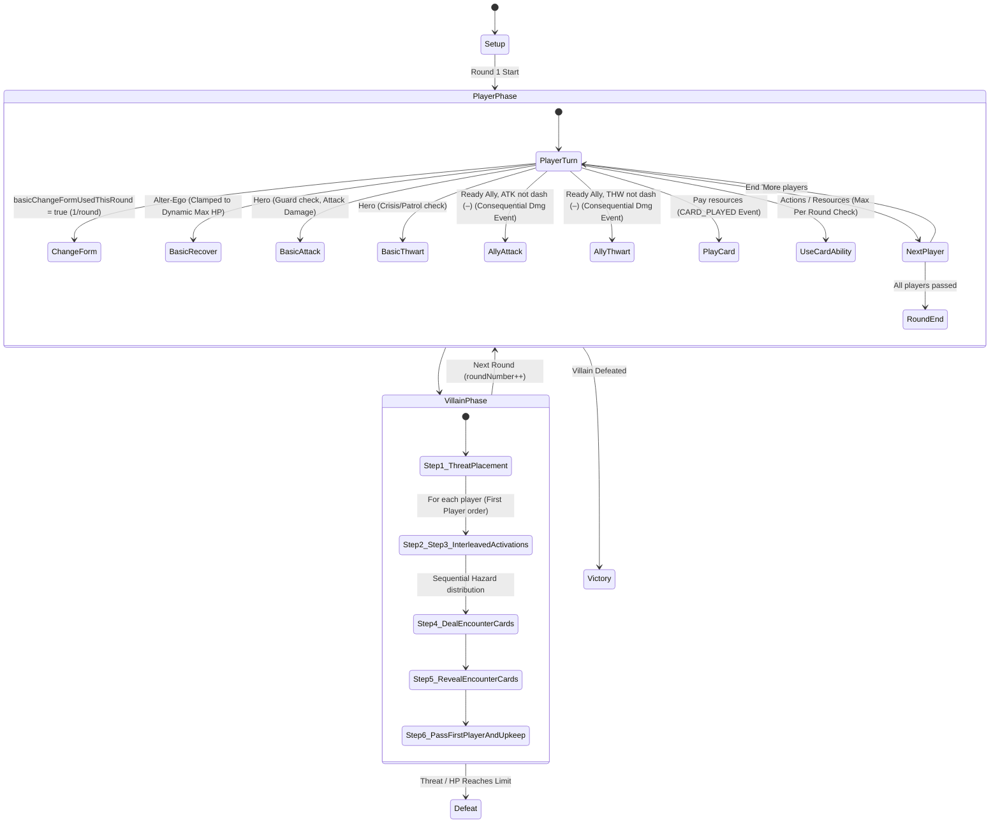
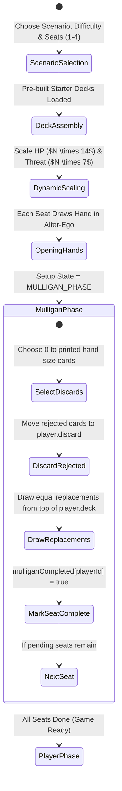
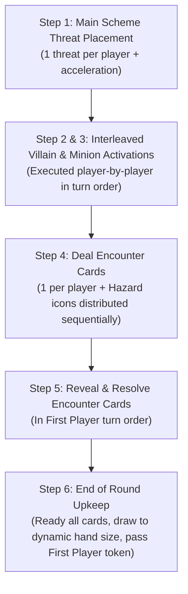

# Marvel Champions Digital (MCD) — Algorithmic Rules Reference

This document provides a **distilled, mathematically precise, and algorithmic specification** of the rules of _Marvel Champions: The Card Game_, strictly derived from **Rules Reference v1.8** and validated against the MCD codebase implementation.

---

## 1. Document Hierarchy & Invariant Principles

```
+-------------------------------------------------------------------------+
|                  1. Card Text (The Golden Rule)                         |
|     - If a card explicitly contradicts general rules, the card wins.    |
+------------------------------------+------------------------------------+
                                     |
                                     v
+-------------------------------------------------------------------------+
|                  2. Rules Reference v1.8 (DEFINITIVE LAW)               |
|     - Strictly supersedes & corrects Learn to Play in all cases.        |
+------------------------------------+------------------------------------+
                                     |
                                     v
+-------------------------------------------------------------------------+
|                  3. Learn to Play Guide (TUTORIAL ONLY)                 |
+-------------------------------------------------------------------------+
```

---

## 2. Core Game Loop & State Machine



---

### 2.1 Setup Phase & Multi-Hero Scaling State Machine (RR v1.8 p. 51)



> [!IMPORTANT]
> **Mulligan Rule Invariant (RR v1.8 p. 51):** On mulligan, rejected cards are placed directly into the player's **discard pile** and replacement cards are drawn from the top of the draw deck. The player deck is **NOT** shuffled during mulligan.

- **Multi-Hero Scaling Formulae ($N = \text{playerCount}$):**
  - $\text{Villain.MaxHealth} = \begin{cases} N \times \text{Card.Health} & \text{if } \text{healthPerHero} = \text{true} \\ \text{Card.Health} & \text{otherwise} \end{cases}$
  - $\text{MainScheme.TargetThreat} = N \times \text{Card.TargetThreat}$
  - $\text{MainScheme.StartingThreat} = \begin{cases} \text{Card.BaseThreat} & \text{if } \text{baseThreatFixed} = \text{true} \\ N \times \text{Card.BaseThreat} & \text{otherwise} \end{cases}$

---

## 3. Formal Play Areas & Zones Architecture (RR v1.8 p. 22-23)

> [!NOTE]
> This represents the **standard base game layout**. Complex modular scenarios (e.g. Tower Defense, Kang, Mutagen Formula) may dynamically register additional custom zones, decks, and side displays via the `ScenarioPlugin` interface.
>
> In the diagram below, `getActiveVillain(state)` / `getActiveMainScheme(state)` denote the **active** villain and main scheme. The canonical state is the `villains[]` / `mainSchemes[]` collections plus `activeVillainId`, read through `getActiveVillain` / `getVillainsInPlay` (ADR-0076; multi-villain scenarios such as MC03 Wrecking Crew keep several villains in play).

```
┌────────────────────────────────────────────────────────────────────────────────────────┐
│                                 SHARED IN-PLAY AREA                                    │
├────────────────────────────────────────┬───────────────────────────────────────────────┤
│ 1. SCENARIO / VILLAIN ZONE             │ 2. ENCOUNTER DRAW & DISCARD ZONES             │
│    • active villain (Card, HP, Status) │    • state.encounterDeck (Draw pile)          │
│    • active villain attachments        │    • state.encounterDiscard (Discard pile)    │
│    • active main scheme (Stage)        │    • state.activeBoostCard (Revealed boost)   │
│    • state.sideSchemes[] (Active)      │                                               │
│    • state.environments[]              │                                               │
└────────────────────────────────────────┴───────────────────────────────────────────────┘
┌────────────────────────────────────────────────────────────────────────────────────────┐
│                           INDIVIDUAL PLAYER PLAY AREA (per player)                     │
├──────────────────────────┬─────────────────────────────┬───────────────────────────────┤
│ 3. IDENTITY & HAND ZONE  │ 4. TABLEAU & ALLIES ZONE    │ 5. ENGAGED & DEALT CARDS ZONE │
│    • player.activeFormCard│   • player.tableau (Upgrades│   • player.engagedMinions[]   │
│    • player.availableForms│     & Supports in play)     │     (Minions on this player)  │
│    • player.currentForm  │   • player.allies[] (Allies │   • player.dealtEncounterCards│
│    • player.hand[]       │     in play, ally limit 3)  │     (Face-down Step 4 queue)  │
│    • player.deck[]       │                             │                               │
│    • player.discard[]    │                             │                               │
└──────────────────────────┴─────────────────────────────┴───────────────────────────────┘
┌────────────────────────────────────────────────────────────────────────────────────────┐
│                              OUT-OF-PLAY / SET-ASIDE ZONES                             │
├────────────────────────────────────────────────────────────────────────────────────────┤
│ • player.setAsideCards[]    (Set-aside Nemesis set waiting for Shadow of the Past)     │
│ • state.victoryDisplay[]    (Defeated cards with Victory keyword)                      │
│ • state.removedFromGame[]   (Removed cards e.g. resolved Obligation)                   │
└────────────────────────────────────────────────────────────────────────────────────────┘
```

### 3.1 Card Physical Orientation & Exhaustion Visuals

- **Exhaustion State vs Visual Layout:**
  - In the game engine state, `card.exhausted = true`.
  - In the UI presentation layer, exhausted cards use a **subtle 15-degree tilt and/or a desaturated (greyed-out) overlay** with interactive disabled state, rather than an intrusive $90^\circ$ rotation that causes board horizontal sprawl.

---

## 4. The 7-Stage Timing Pipeline & Nested Resolution Stack

Whenever an in-game event or activation occurs, it executes within a **Nested Resolution Stack** to ensure uninterrupted state tracking:

```typescript
function ProcessEventPipeline(event: GameEvent, state: GameState): GameState {
  // 1. FORCED INTERRUPTS (Mandatory, executed in First Player order / Player-selected order if simultaneous)
  state = ExecuteForcedInterrupts(event, state);
  if (event.cancelled) return state;

  // 2. VOLUNTARY INTERRUPTS (Player decision prompt with explicit "Pass / Do Nothing" option)
  state = ExecuteInterrupts(event, state); // e.g. Spider-Sense, Backflip
  if (event.cancelled) return state;

  // 3. EVENT RESOLUTION (Primary action or effect executes)
  state = ExecuteEventResolution(event, state);

  // 4. REPLACEMENT EFFECTS (e.g. Tough status card absorption)
  state = ExecuteReplacementEffects(event, state);

  // 5. POST-RESOLUTION STATE MUTATION (Check character defeat, threat thresholds)
  state = CheckStateBasedEffects(event, state);

  // 6. FORCED RESPONSES (Mandatory reactions to event completion)
  state = ExecuteForcedResponses(event, state);

  // 7. VOLUNTARY RESPONSES (Player decision prompt with "Pass / Do Nothing")
  state = ExecuteResponses(event, state);

  return state;
}
```

### Simultaneous Trigger Ordering (RR v1.8 p. 5)

If multiple `FORCED` triggers or multiple voluntary reactions are eligible at the same step, the active/first player chooses the sequence of resolution.

---

## 5. Algorithmic Player Turn Actions (RR v1.8)

### Algorithm 5.0: RESOLVE_MULLIGAN (RR v1.8 p. 23–24)

1. Player selects $k$ cards from opening hand to reject ($0 \le k \le \text{hand.length}$).
2. Rejected cards move to `player.discard` (**NOT shuffled into deck**).
3. Draw $k$ cards from the top of `player.deck`.
4. Set `player.mulliganCompleted = true`.

### Algorithm 5.1: CHANGE_FORM (RR v1.8 p. 13–14)

- A player may flip their identity form **once per round as a basic turn action**:
  $$\text{if } \text{player.basicChangeFormUsedThisRound} = \text{false} \rightarrow \text{Flip Form}, \text{basicChangeFormUsedThisRound} = \text{true}.$$
- Card effects that instruct the player to change form (e.g. _Split Personality_) do **NOT** count against or require `basicChangeFormUsedThisRound`.

### Algorithm 5.2: BASIC_RECOVER (RR v1.8 p. 23)

- Alter-Ego exhausts to heal $\text{REC}$ points.
- Health is strictly clamped to dynamic maximum health:
  $$\text{player.health} = \min(\text{player.maxHealth}, \text{player.health} + \text{player.activeFormCard.rec}).$$

### Algorithm 5.3: BASIC_ATTACK vs DIRECT_DAMAGE (RR v1.8 p. 5–6, 26)

- **Attack Action (`isAttack: true`):**
  - Target must be a legal enemy (checks `Guard` keyword on engaged minions: an engaged minion with `Guard` blocks only the player it is engaged with and their allies from attacking the villain; other players remain free to attack the villain or the Guard minion per RR v1.8 p. 15).
  - Triggers Defense reactions, _Retaliate_ keywords, and _Overkill_ calculations.
  - Fires the `BASIC_ATTACK_PERFORMED` trigger after a basic attack (`src/engine/pipeline/actions/combat.ts`); excess damage is reported as the `EXCESS_DAMAGE_DEALT` result fact (`facts.excessDamage`, `gate-params.ts`).
- **Direct Damage (`isAttack: false`):**
  - Ignores `Guard` and does not trigger _Retaliate_ or attack-specific interrupts (e.g. _Ground Stomp_, _Energy Channel_).

### Algorithm 5.4: BASIC_THWART & THREAT_REMOVAL (RR v1.8 p. 11, 20, 29, 30)

- **Thwart Action & Threat Removal Requirements:**
  - Requires at least one eligible scheme target in play with threat $> 0$.
  - **Crisis Keyword (RR v1.8 p. 14):** While a side scheme with a Crisis icon is in play, players cannot remove threat from the main scheme.
  - **Patrol Keyword (RR v1.8 p. 32):** While an engaged minion with Patrol is in play with the acting player, that player cannot thwart the main scheme.
  - If all side schemes have $0$ threat and the main scheme is blocked by Crisis or Patrol (or has $0$ threat), no threat can be removed, and the thwart action cannot be initiated.

### Algorithm 5.5: ABILITY_INITIATION & TARGET_VALIDITY (RR v1.8 p. 15–16, 29)

- **Pre-Execution Invariant (`canInitiateAbility`):**
  - A card or ability cannot be initiated if its effect has no potential to change the game state.
  - **Thwart & Threat Removal:** Requires $\text{eligibleThreat} > 0$ across unblocked schemes in play.
  - **Attack & Damage:** Requires at least one targetable enemy in play (respecting Guard on engaged minions).
  - In-play card abilities and hand event cards that lack valid targets cannot be initiated, preventing cost payment, counter deduction, or exhaustion.

---

## 6. The 6-Step Villain Phase State Machine (RR v1.8 p. 22)



### Interleaved Step 2 & 3 Activation Algorithm:

```typescript
for (const player of state.playersInTurnOrder) {
  // 1. Villain activates against player
  if (player.currentForm === 'alter_ego') {
    executeVillainSchemeAgainstPlayer(state, player);
  } else {
    executeVillainAttackAgainstPlayer(state, player);
  }

  // 2. All minions engaged with player activate against player
  for (const minion of player.engagedMinions) {
    if (player.currentForm === 'alter_ego') {
      executeMinionSchemeAgainstPlayer(state, minion, player);
    } else {
      executeMinionAttackAgainstPlayer(state, minion, player);
    }
  }
}
```

### Sequential Hazard Icon Distribution (Step 4):

Encounter cards from Hazard icons are distributed sequentially in turn order starting from the First Player:
$$\text{Extra Card } h \rightarrow \text{Player } ((\text{firstPlayerIndex} + h) \pmod{\text{playerCount}}).$$

### Phase & Round Lifecycle Triggers & Limit Resets (RR v1.8 p. 15):

The engine pipeline dispatches discrete lifecycle triggers and performs atomic limit resets across phase and round boundaries:

- `ROUND_BEGAN` / `ROUND_ENDED`: Round counter increments, First Player token passes, and `usedAbilitiesThisRound = {}` resets.
- `PLAYER_PHASE_BEGAN` / `PLAYER_PHASE_ENDED`: Player turn loop starts/ends, `basicChangeFormUsedThisRound = false` resets, and `usedAbilitiesThisPhase = {}` resets.
- `VILLAIN_PHASE_BEGAN` / `VILLAIN_PHASE_ENDED`: Step 1 threat starts / Step 5 reveals complete, and `usedAbilitiesThisPhase = {}` resets.

---

## 7. Form Change Invariants (RR v1.8 p. 21 "Change Form")

- **Basic Form Change (1/Round):**
  $$\text{Player.basicChangeFormUsedThisRound} = \begin{cases} \text{true} & \text{after basic flip action} \\ \text{false} & \text{upon } \text{ROUND\_BEGAN} \end{cases}$$
- **Card-Driven Form Flips (_Split Personality_ `01025`):**
  Card abilities flip `Player.currentForm` directly and are **completely independent of** the basic 1/round limit.

---

## 8. Reusable Effect Primitives Reference (`src/engine/effects/handlers/`)

| Primitive Name      | Target Selector                                     | Description                                                                                                                    |
| :------------------ | :-------------------------------------------------- | :----------------------------------------------------------------------------------------------------------------------------- |
| `DEAL_DAMAGE`       | `CHOSEN_ENEMY` \| `ALL_ENEMIES` \| `ALL_HEROES`     | Damage resolution with Tough card discard, armor counters, and overkill.                                                       |
| `REMOVE_THREAT`     | `MAIN_SCHEME` \| `CHOSEN_SCHEME`                    | Threat removal enforcing Crisis keyword restrictions.                                                                          |
| `DRAW_CARDS`        | `SELF_IDENTITY` \| `ACTIVE_PLAYER` \| `ALL_PLAYERS` | Draws cards from draw deck into hand, with optional `limit: "HAND_SIZE" \| "PRINTED_HAND_SIZE"` (_Split Personality_ `01025`). |
| `FLIP_FORM`         | `SELF`                                              | Flips identity card form without consuming basic flip (_Split Personality_ `01025`).                                           |
| `MODIFY_HAND_SIZE`  | `SELF_IDENTITY`                                     | Dynamic aura modifying hand size based on in-play tableau upgrades.                                                            |
| `PLAYER_CHOICE`     | `SELF_IDENTITY`                                     | Renders Pop-Art decision prompt modal (_Nick Fury_ `01084` choose 1 of 3, _Hydra Bomber_).                                     |
| `VILLAIN_SCHEMES`   | `ACTIVE_PLAYER`                                     | Immediate villain scheme activation against player (_Advance_ `01186`).                                                        |
| `VILLAIN_ATTACKS`   | `ACTIVE_PLAYER`                                     | Immediate villain attack activation against player (_Assault_ `01187`).                                                        |
| `MODIFY_ALLY_LIMIT` | `SELF_IDENTITY` \| `ALL_PLAYERS`                    | Increases maximum ally limit by $N$ (_The Triskelion_ `01073`).                                                                |

---

## 9. Worked Card Breakdowns

This document translates the natural language of Marvel Champions card text into precise, unambiguous, step-by-step algorithmic operations for the rules engine. It serves as the definitive reference for developers and rules designers when authoring or reviewing supplemental data (`src/data/supplemental/`).

### 9.1 Specification Template

For each card, mechanics are broken down using the following standard schema:

```markdown
### [Card Name] (`#{card_code}`) — [Type]

- **MarvelCDB Link:** [https://marvelcdb.com/card/{card_code}](https://marvelcdb.com/card/{card_code})
- **Official Printed Text:** `"<Printed card text>"`
- **Ability Timing & Trigger:** `<TIMING>` @ `<TRIGGER>`
- **Step-by-Step Resolution:**
  1. **[Step 1]** ...
  2. **[Step 2]** ...
- **Cost & State Changes:** ...
- **Edge Cases & Official Rulings (FAQ):** ...
```

---

### 9.2 Core Set Player Cards Breakdown

#### Spider-Man (`#01001a`) — Hero Identity

- **MarvelCDB Link:** [https://marvelcdb.com/card/01001a](https://marvelcdb.com/card/01001a)
- **Official Printed Text:** _"Spider-Sense — **Interrupt**: When the villain initiates an attack against you, draw 1 card."_
- **Ability Timing & Trigger:** `INTERRUPT` @ `ENEMY_INITIATES_ATTACK`
- **Step-by-Step Resolution:**
  1. **Trigger Window:** Fires immediately when the Villain targets this Hero for an attack (Step 2 of Villain Phase or via encounter cards like _Assault_).
  2. **Timing Precedence:** Resolves **BEFORE** defenders are declared, before boost cards are dealt, and before damage is calculated (RR v1.8 p. 12).
  3. **Effect Execution:** Draw 1 card from controller's deck into hand (`DRAW`).
- **Edge Cases & Official Rulings:**
  - If a minion attacks Spider-Man, Spider-Sense does **NOT** trigger (only the Villain).
  - If the villain attacks another hero and Spider-Man defends, Spider-Sense does **NOT** trigger (Spider-Man was not the initiated target).

---

#### Peter Parker (`#01001b`) — Alter-Ego Identity

- **MarvelCDB Link:** [https://marvelcdb.com/card/01001b](https://marvelcdb.com/card/01001b)
- **Official Printed Text:** _"Scientist — **Resource**: Generate a [mental] resource. (Limit once per round.)"_
- **Ability Timing & Trigger:** `RESOURCE` (Limit: `ONCE_PER_ROUND`)
- **Step-by-Step Resolution:**
  1. **Action Window:** Can be used while paying for a card, an ability cost, or during an open resource window while in Alter-Ego form.
  2. **Limit Check:** Verify `usedAbilitiesThisRound['01001b_scientist'] < 1`.
  3. **Effect Execution:** Generate $1$ [mental] resource to satisfy cost.
  4. **State Tracking:** Record ability usage for the round.

---

#### Black Cat _(Felicia Hardy)_ (`#01002`) — Ally

- **MarvelCDB Link:** [https://marvelcdb.com/card/01002](https://marvelcdb.com/card/01002)
- **Official Printed Text:** _"**Forced Response**: After you play Black Cat, discard the top 2 cards of your deck. Add each card with a printed [mental] resource discarded this way to your hand."_
- **Ability Timing & Trigger:** `FORCED_RESPONSE` @ `CARD_PLAYED`
- **Step-by-Step Resolution:**
  1. **Trigger:** Controller plays Black Cat from hand and places her into play.
  2. **Step 1 (Inspect/Draw Top 2):** Look at the top 2 cards of controller's draw deck.
  3. **Step 2 (Filter):** Inspect the printed resource icons of each of the 2 cards.
  4. **Step 3 (Discard Non-Mental):** Move any card that does not have at least 1 printed [mental] resource to the discard pile.
  5. **Step 4 (Add Mental to Hand):** Place any card with a printed [mental] resource directly into controller's hand.
  6. **Passive Consequential:** Black Cat has `attackCost: 0` (takes 0 consequential damage when performing a basic attack).
- **Edge Cases & Official Rulings:**
  - **Wild Resources:** Wild resources count as matching [mental] if printed with wild or explicitly designated by card text.
  - **Empty Deck:** If only 1 card is left in deck, discard that 1 card, resolve mental filter, and immediately trigger deck reshuffle + 1 encounter card deal (RR v1.8 p. 11).

---

#### Backflip (`#01003`) — Event (Defense)

- **MarvelCDB Link:** [https://marvelcdb.com/card/01003](https://marvelcdb.com/card/01003)
- **Official Printed Text:** _"**Interrupt** (defense): When you would take any amount of damage from an attack, prevent all of that damage."_
- **Ability Timing & Trigger:** `INTERRUPT` @ `DAMAGE_WOULD_BE_TAKEN`
- **Step-by-Step Resolution:**
  1. **Trigger Window:** Fires during Step 4 of enemy attack resolution when attack damage has been calculated and is about to be dealt to this hero.
  2. **Cost:** Discard _Backflip_ from hand to player discard pile.
  3. **Effect Execution:** Set final incoming damage to $0$.

---

#### Web-Shooter (`#01008`) — Upgrade

- **MarvelCDB Link:** [https://marvelcdb.com/card/01008](https://marvelcdb.com/card/01008)
- **Official Printed Text:** _"Uses (3 web counters). **Hero Resource**: Exhaust Web-Shooter and remove 1 web counter from it → generate a [wild] resource."_
- **Ability Timing & Trigger:** `RESOURCE`
- **Step-by-Step Resolution:**
  1. **Setup on Enter:** Card enters play with `tokens.counters = 3`.
  2. **Cost Check:** Card must be unexhausted (`exhausted === false`) and have `tokens.counters >= 1`.
  3. **Activation:** Exhaust card, decrement `tokens.counters` by 1.
  4. **Effect:** Generate 1 [wild] resource.
  5. **Discard on Empty:** If `tokens.counters === 0`, immediately discard _Web-Shooter_ to player discard pile.

---

#### Emergency (`#01085`) — Event (Thwart)

- **MarvelCDB Link:** [https://marvelcdb.com/card/01085](https://marvelcdb.com/card/01085)
- **Official Printed Text:** _"**Interrupt** (thwart): When the villain schemes, reduce the amount of threat placed on the scheme by 1."_
- **Ability Timing & Trigger:** `INTERRUPT` @ `THREAT_WOULD_BE_PLACED`
- **Step-by-Step Resolution:**
  1. **Trigger Window:** When the **Villain** (not minions) executes a Scheme activation (Step 2 of Villain Phase or via encounter cards like _Advance_).
  2. **Player Prompt:** The controller is prompted: _"Play Emergency to reduce scheme threat by 1?"_
  3. **Decision - Accept:** Discard _Emergency_ from hand, subtract 1 from total scheme threat before it is placed on the scheme.
  4. **Decision - Decline:** _Emergency_ remains in hand; full scheme threat is placed.
- **Form Invariance:** Because _Emergency_ has neutral `INTERRUPT` timing, it can be played while the controller is in **Hero form** or **Alter-Ego form**.

---

#### Tenacity (`#01093`) — Upgrade

- **MarvelCDB Link:** [https://marvelcdb.com/card/01093](https://marvelcdb.com/card/01093)
- **Official Printed Text:** _"Attach to your hero. Max 1 per hero. **Hero Action**: Spend a [physical] resource and discard this card → ready your hero."_
- **Ability Timing & Trigger:** `HERO_ACTION`
- **Step-by-Step Resolution:**
  1. **Play Condition:** Must be played in Hero form (attaches to your hero).
  2. **In-Play Activation:** While in Hero form, spend 1 [physical] resource and discard _Tenacity_.
  3. **Effect Execution:** Set `hero.exhausted = false` (readies the hero).

---

#### The Triskelion (`#01073`) — Support

- **MarvelCDB Link:** [https://marvelcdb.com/card/01073](https://marvelcdb.com/card/01073)
- **Official Printed Text:** _"Play only if your identity has the [[Avenger]] trait. Max 1 per player. You get +1 ally limit."_
- **Ability Timing & Trigger:** `CONSTANT` ➔ `MODIFY_ALLY_LIMIT` (+1)
- **Step-by-Step Resolution:**
  1. **Play Requirement:** Controller must possess the `Avenger` trait.
  2. **Active State:** While in play, dynamically increases controller's ally limit from 3 to 4 (`getPlayerAllyLimit`).
  3. **Leaves Play:** When _The Triskelion_ is discarded, ally limit reverts to 3. If controller controls 4 allies, they must immediately choose and discard 1 ally to satisfy board limit (RR v1.8 p. 3).

---

#### Nick Fury (`#01084`) — Ally

- **MarvelCDB Link:** [https://marvelcdb.com/card/01084](https://marvelcdb.com/card/01084)
- **Official Printed Text:** _"**Forced Response**: After Nick Fury enters play, choose one: remove 2 threat from a scheme; or draw 3 cards; or deal 4 damage to an enemy. At the end of the round, if Nick Fury is still in play, discard him."_
- **Ability Timing & Trigger:**
  - Ability 1: `FORCED_RESPONSE` @ `ENTERS_PLAY` ➔ `PLAYER_CHOICE` (Draw 3 cards, Remove 2 threat, or Deal 4 damage)
  - Ability 2: `FORCED_RESPONSE` @ `ROUND_ENDED` ➔ `DISCARD` (`source: 'SELF'`)
- **Step-by-Step Resolution:**
  1. **When Enters Play:** Controller chooses 1 of 3 options:
     - Option A: Draw 3 cards (`DRAW`).
     - Option B: Remove 2 threat from chosen scheme (`REMOVE_THREAT`).
     - Option C: Deal 4 damage to chosen enemy (`DEAL_DAMAGE`).
  2. **Round End:** During Upkeep, if Nick Fury is in play, automatically move him to discard pile.

---

### 9.3 Rhino Scenario & Encounter Cards Breakdown

#### Rhino (Stage I & II) (`#01094`, `#01095`) — Villain

- **MarvelCDB Link:** [https://marvelcdb.com/card/01094](https://marvelcdb.com/card/01094)
- **Stage II When Revealed:** _"Search the encounter deck and discard pile for the Breakin' & Takin' side scheme and reveal it. Shuffle the encounter deck."_
- **Step-by-Step Resolution:**
  1. When Rhino Stage I is defeated, transition to Stage II.
  2. Search encounter deck and discard for side scheme `01107` (_Breakin' & Takin'_).
  3. Put `01107` into play and place starting threat ($2 + 1 \times \text{players}$).
  4. Shuffle the encounter deck.

---

#### Armored Rhino Suit (`#01098`) — Attachment

- **MarvelCDB Link:** [https://marvelcdb.com/card/01098](https://marvelcdb.com/card/01098)
- **Official Printed Text:** _"Attach to Rhino. **Forced Interrupt**: When any amount of damage would be dealt to Rhino, place it here instead. Then, if there is at least 5 damage here, discard Armored Rhino Suit."_
- **Ability Timing & Trigger:** `FORCED_INTERRUPT` @ `DAMAGE_WOULD_BE_TAKEN`
- **Step-by-Step Resolution:**
  1. When damage is dealt to Rhino, redirect damage onto _Armored Rhino Suit_ tokens (`tokens.damage += amount`).
  2. Rhino takes $0$ damage.
  3. Check condition: If `tokens.damage >= 5`, discard _Armored Rhino Suit_ to encounter discard.

---

#### Charge (`#01099`) — Attachment

- **MarvelCDB Link:** [https://marvelcdb.com/card/01099](https://marvelcdb.com/card/01099)
- **Official Printed Text:** _"Attach to Rhino. [star] **Forced Interrupt**: When Rhino attacks, the attack gains overkill. At the end of this attack, discard Charge."_
- **Step-by-Step Resolution:**
  1. Attaches to Rhino (+3 ATK).
  2. When Rhino initiates an attack, set `attack.hasOverkill = true`.
  3. After the attack finishes resolving, move _Charge_ to encounter discard.
