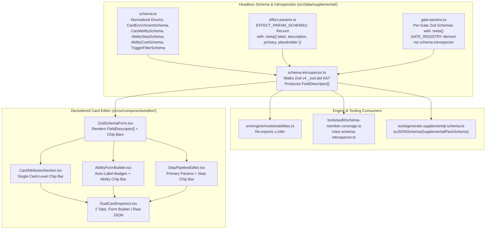

# Card Editor Re-Architecture Plan (Complete Specification)

> **Status:** Implemented — Phases 1–6 (2026-10-16). Awaiting merge to `main`.
> **Milestone:** Gate 1 — Rhino Release (user-added scope, 2026-10-15).
> **Depends on:** Issue [#316](https://github.com/SteveRodrigue/MCD/issues/316) (Dash `null` basic powers) lands first. See §0.2.

## 0. Scope, Gate & Dependencies

### 0.1 Gate tie-in

This plan is a user-directed addition to **Gate 1 — Rhino Release**. The Gate 1 scope boundary in
[`docs/roadmap_and_milestones.md`](../roadmap_and_milestones.md) explicitly accepts "localized technical debt or refactors"
that close the vertical slice. The Card Editor is the authoring tool for all Gate 1 supplemental data.

Tracking steps (done at delivery time, not before approval):

1. Open a GitHub issue "Card Editor re-architecture (schema-driven forms)" on milestone `Gate 1 — Rhino Release`, linking this plan.
2. Add a row to the work queue in [`teamwork_status_and_next_target.md`](teamwork_status_and_next_target.md) after #316.

### 0.2 Order relative to Issue #316

**Do #316 first, as its own bug fix.** Reasons:

- #316 is a P0 engine bug. It changes `NormalizedCard` power types (`attack`, `thwart`, etc. may become "dash"/`null`) and the engine's legality and modifier rules. That is engine work with its own TDD cycle, separate from an editor refactor.
- Both touch the same ally block in [`card-loader.ts:389-410`](../../src/data/importer/card-loader.ts#L389-L410). Doing #316 first avoids a merge conflict and lets this plan rebase onto the final types.
- The read-only upstream badges in Phase 3 display those power values, so they should show the final dash rendering.

This plan keeps only the **consequential-cost default** fix (§1.3) because it is tied to purging the `attackCost` / `thwartCost` overrides. It is not a dash-value fix.

---

## 1. Rules & Spec Analysis

### 1.1 Event ability resource costs (`01004`, `01024`, `01078`)

- Enhanced Spider-Sense (`01004`), One-Two Punch (`01024`) and Get Behind Me! (`01078`) print **no ability cost**. Their only cost is the printed event cost (1), already in upstream `raw.cost`.
- Engine behavior today: [`cost-engine.ts:419-436`](../../src/engine/pipeline/cost-engine.ts#L419-L436) and [`:763-782`](../../src/engine/pipeline/cost-engine.ts#L763-L782) fall back to the printed card cost **only when the ability declares no resource cost**. The supplemental `resourceCost: 1` therefore *replaces* the printed cost (no double charge), but pins a hand-copied value and hides the upstream one.
- **Resolution:** delete `cost` from these 3 abilities. Behavior is unchanged (printed cost is 1), and the engine reads the cost from upstream. Numeric `resourceCost` then has zero users and is removed from the schema.

### 1.2 Typed ability resource costs (`cost.resources` → `resourceCost` map)

- RR v1.8 (Resources, Costs): "Spend a [energy] resource" requires a resource of that type; a wild resource can pay it. The typed map `{ energy: 1 }` expresses exactly this. `cost-engine.ts` already treats an object `resourceCost` with the same semantics as `resources: [type]`.
- `01010a` Rechannel ("Spend a [energy] resource") → `{ energy: 1 }`. `01039` Rocket Boots ("spend a [mental] resource") → `{ mental: 1 }`.
- `wild` remains a legal key only for a printed "Spend a [wild] resource" cost.

### 1.3 Ally consequential damage default

- RR v1.8 (Consequential Damage): an ally takes damage equal to the number of consequential icons under ATK / THW. No icons means 0.
- Upstream omits `attack_cost` / `thwart_cost` when there are no icons. The loader currently defaults a missing value to **1**, which is wrong. The old `does not take consequential damage after attacking` text check matches **no** upstream card.
- **Resolution:** `raw.attack_cost ?? 0` and `raw.thwart_cost ?? 0`; delete the text check. Affected upstream allies (16 total, all packs):

| Code | Name | ATK cost | THW cost | Note |
| :-- | :-- | :-- | :-- | :-- |
| `01002` | Black Cat | missing → 0 | 1 | Supplemental `attackCost: 0` override deleted (now redundant) |
| `01050`, `62020` | Hulk | 1 / 2 | missing | THW is dash (`null`): handled by #316 |
| `46003` | Snow Clone | 1 | missing | THW is dash: #316 |
| `44013`–`44016`, `44043`–`44045` | Deadpool allies, Bob, Negasonic | missing → 0 | missing → 0 | Gate 4 packs; verify against card images before Gate 4 |
| `60020` Cloak, `21019` Blade, `36014` Havok | | missing → 0 | 1 or missing → 0 | Havok's "+1 consequential" is a card ability, not a printed icon |
| `32066` Robert Kelly, `40130` Hope Summers | | ATK & THW dash | | #316 |

Gate 1 impact: only Black Cat (`01002`), whose behavior is unchanged.

### 1.4 Victory X

- RR v1.8 (Victory X): a card with Victory X goes to the victory display when defeated. 128 upstream cards print it, including `Victory 0` and 6 with negative values (`50091`, `50125`, `50126`, `32088b`, `40079`, `27181`).
- **Resolution:** derive from printed text via `getPrintedKeywordValue(raw.text, 'victory')` with a signed pattern. The supplemental `victoryPoints` field is never used by any pack and is removed.

### 1.5 Ability labels

- RR v1.8 glossary L: labels "(attack)", "(thwart)", "(defense)" are printed. [`02_timings_and_triggers.md`](../specifications/supplemental/02_timings_and_triggers.md) already says packs do not declare manual labels; no pack does. Removing the manual override is by design: labels come only from `parseAbilityLabelsFromText(raw.text)`.

---

## 2. Locked-In Architectural Decisions (from `/grill-me`, revised)

| # | Decision Area | Locked-In Resolution |
| :- | :--- | :--- |
| **1** | **Core Architecture** | **Option A:** Annotate Zod v4 schemas in [`schema.ts`](../../src/data/supplemental/schema.ts), [`effect-params.ts`](../../src/data/supplemental/effect-params.ts), and [`gate-params.ts`](../../src/data/supplemental/gate-params.ts) with `.meta({...})`. Introspect the Zod AST via a headless `src/data/supplemental/schema-introspector.ts` (extracting the existing `_zod.def` walker from [`schema-member-coverage.ts:71`](../../tools/audit/schema-member-coverage.ts#L71)) and render forms via `<ZodSchemaForm />`. |
| **2** | **Printed Ability Labels (`labels`)** | **Purge from Supplemental Schema & Editor Form:** Delete `AbilityLabelSchema` and `labels` from `CardAbilitySchema`, remove the manual override branch in [`card-loader.ts:240-242`](../../src/data/importer/card-loader.ts#L240-L242), delete checkboxes in [`AbilityFormBuilder.tsx:488-524`](../../src/ui/components/editor/AbilityFormBuilder.tsx#L488-L524), and render read-only derived label badges in the Ability Accordion Header. Runtime `CardAbility.labels` in `src/engine/models/abilities.ts` stays. |
| **3** | **Duplicate Step-Level Fields (`step.target`, `step.filter`, `step.distinctFrom`)** | **Purge from `AbilityStepSchema`:** Only `01034` uses one (`step.target`); no pack uses `step.filter` or `step.distinctFrom`. Migrate `01034` to `effectParams.target`, then remove the 3 fields from the schema, `StepPipelineEditor.tsx`, and every engine fallback (§4 Phase 1.2). |
| **4** | **Dead `effectParams`** | **Purge `ADD_THREAT.condition`** (0 pack users, 0 engine readers; retired by ADR-0080) and its log-formatter remnant ([`comic-log-formatter.ts:610`](../../src/ui/utils/comic-log-formatter.ts#L610)). Keep engine-backed parameters (`EXECUTE_SPECIAL.sequenceOrder`, `DRAW.targetPlayerId`, `PLAY_FROM_ZONE.costReduction`, `PLAYER_CHOICE.isVoluntary`, `REMOVE_COUNTERS_MATCHING_FILTER`). |
| **5** | **`gate-params.ts` Unification** | Annotate gate param schemas with `.meta()` and derive `GATE_REGISTRY[gate].fields` and `hasRequiredParams` via `schema-introspector.ts` (no manual field arrays). |
| **6** | **Redundant "Visual Review" Tab** | Delete the `summary` tab in [`DualCardInspector.tsx:527-870`](../../src/ui/components/editor/DualCardInspector.tsx#L527-L870), keeping `Form Builder` + `Raw JSON`. |
| **7** | **9 Upstream-Derived `CardEnrichment` Fields** | **Purge & Replace with Single Chip Bar:** Remove `traits`, `keywords`, `maxPerPlayer`, `isLandscape`, `restrictedSlots`, `additionalBoostCards`, `attackCost`, `thwartCost`, `victoryPoints` from `CardEnrichmentSchema`, all packs, every loader/engine reader (§4 Phase 1.3), and `KNOWN_GAPS`. Each has an upstream fallback already in the loader. Replace the 5 accordions and `Smart View / Show All` toggle in `CardAttributesSection.tsx` with one Card-Level Chip Bar (`[+ Play Requirements] [+ Uses / Counters] [+ Attachment Host] [+ Obligation Recipient] [+ Cross-Player Control] [+ Errata]`). |
| **8** | **Ability Resource Costs** | **Unify on typed map `resourceCost`:** `z.object({ physical, energy, mental, wild }: z.number().int().positive().optional()).strict()`. Remove `cost.resources` and numeric `resourceCost`. Migrate `01010a` and `01039` to the map; **delete** the bogus `cost` on `01004`, `01024`, `01078` (§1.1). |

---

## 3. Target Architecture



### 3.1 Resulting `CardEnrichmentSchema`

```ts
export const CardEnrichmentSchema = z
  .object({
    noSupplementalNeeded: z.boolean().optional(),
    abilities: z.array(CardAbilitySchema).optional(),
    playRequirements: PlayRequirementsSchema.optional(),
    playUnderAnyPlayerControl: z.boolean().optional(),
    uses: CardUsesSchema.optional(),
    recipient: PlayerRecipientSchema.optional(),
    attachTo: AttachToSchema.optional(),
    errata: z.string().nullable().optional(),
    audit: CardAuditRecordSchema.optional(),
  })
  .strict();
```

### 3.2 Resulting `AbilityStepSchema`

```ts
export const AbilityStepSchema = z
  .object({
    id: z.string().optional(),
    effect: EffectTypeSchema,
    gate: StepGateSchema.optional(),
    gateParams: z.record(z.string(), z.any()).optional(),
    effectParams: z.record(z.string(), z.any()).optional(),
    cannotBeCanceled: z.boolean().optional(),
  })
  .strict()
  .superRefine(/* validates gateParams against GATE_REGISTRY[step.gate].schema
                   and effectParams against EFFECT_PARAM_SCHEMAS[step.effect] */);
```

---

## 4. Phased Execution Plan

### 4.0 Supplemental data inventory (all 5 packs)

Scanned `core.json` (101 cards), `core_encounter.json` (56), `aoa_encounter.json` (1), `cw_encounter.json` (1), `mts.json` (1):

| Item | Cards | Action |
| :-- | :-- | :-- |
| `abilities[].labels` | none | — |
| `step.target` | `01034` (core) | Move to `effectParams.target` |
| `step.filter`, `step.distinctFrom` | none | — |
| `traits`, `keywords`, `isLandscape`, `restrictedSlots`, `additionalBoostCards`, `thwartCost`, `victoryPoints` (card level) | none | — |
| `attackCost` | `01002` (core) | Delete (upstream `?? 0` gives 0) |
| `maxPerPlayer` | `01018`, `01057`, `01063`, `01065`, `01081`, `01091`, `01092` (core) | Delete (verified: `parseMaxPerPlayer` returns 1 from text for all 7) |
| `cost.resources` | `01010a`, `01039` (core) | Migrate to `resourceCost` map |
| numeric `cost.resourceCost` | `01004`, `01024`, `01078` (core) | Delete `cost` (§1.1) |
| typed `cost.resourceCost` (already valid) | `01018`, `01026`, `01068`, `01075`, `01093` (core); `01100` (core_encounter) | — |
| `ADD_THREAT.effectParams.condition` | none | — |

### Phase 1: Schema & Data Purges

1. **Purge `labels` from the supplemental schema:**
   - [`schema.ts`](../../src/data/supplemental/schema.ts): remove `AbilityLabelSchema`, `AbilityLabel`, and `labels` from `CardAbility` / `CardAbilitySchema`.
   - [`card-loader.ts:240-242`](../../src/data/importer/card-loader.ts#L240-L242): remove the manual override branch.
   - [`src/engine/models/abilities.ts`](../../src/engine/models/abilities.ts): keep runtime `labels?: ('ATTACK' | 'THWART' | 'DEFENSE')[]` on `CardAbility`.
2. **Purge `step.target`, `step.filter`, `step.distinctFrom`:**
   - `core.json`: `01034` → `effectParams.target: "CHOSEN_PLAYER"`.
   - `schema.ts`: remove the 3 fields from `AbilityStep` / `AbilityStepSchema`, and `DistinctFromSchema` if it has no other user.
   - [`effects/index.ts`](../../src/engine/effects/index.ts): remove fallbacks at lines 1299, 1812, 3930, 4015, 4241, 4396, 4982, 5001, 5566.
   - [`legality-checker.ts`](../../src/engine/pipeline/legality-checker.ts): remove the step-level fallbacks.
3. **Purge the 9 upstream-derived card fields:**
   - [`card-loader.ts`](../../src/data/importer/card-loader.ts):
     - [`printedKeywordPattern`](../../src/data/importer/card-loader.ts#L109-L111): `(\\s+(-?\\d+))?$`; populate `victory` / `Keyword.VICTORY` in `parseKeywords` and `normalizeRawCard`.
     - Ally consequential costs: `raw.attack_cost ?? 0` / `raw.thwart_cost ?? 0`; delete the text check (§1.3).
     - Remove enrichment override branches: `maxPerPlayer` (line 73), `keywords` (173–177), `isLandscape` (261), `restrictedSlots` (284), `traits` (292), `additionalBoostCards` (340), `attackCost` / `thwartCost` (391–392).
   - [`stat-calculator.ts:610`](../../src/engine/pipeline/stat-calculator.ts#L610) and [`:723`](../../src/engine/pipeline/stat-calculator.ts#L723): remove the `enrichment?.keywords` reads (keywords come only from `card.keywords`).
   - [`src/engine/models/abilities.ts:236`](../../src/engine/models/abilities.ts#L236): remove `victoryPoints` from the engine-side enrichment type. Check [`src/engine/models/card.ts`](../../src/engine/models/card.ts) for the same fields.
   - [`card-text-parser/parser.ts:79`](../../src/tools/card-text-parser/parser.ts#L79): stop emitting `enrichment.maxPerPlayer`.
   - `schema.ts`: remove the 9 fields from `CardEnrichmentSchema`.
   - [`schema-member-coverage.ts:43`](../../tools/audit/schema-member-coverage.ts#L43): remove `'cards.victoryPoints'` from `KNOWN_GAPS`.
   - [`tools/audit/supplemental-declarations-analyzer.ts`](../../tools/audit/supplemental-declarations-analyzer.ts): drop references to removed fields.
   - `core.json`: delete `01002.attackCost` and the 7 `maxPerPlayer` entries.
4. **Unify `AbilityCostSchema.resourceCost`:**
   - `schema.ts`: remove `resources`; define `resourceCost` as the strict typed map.
   - `core.json`: `01010a` → `{ energy: 1 }`, `01039` → `{ mental: 1 }`; delete `cost` on `01004`, `01024`, `01078`.
   - [`cost-engine.ts`](../../src/engine/pipeline/cost-engine.ts) (`extractResourceCost`, lines 64–100), [`legal-actions-generator.ts:99-116, 268-285`](../../src/engine/pipeline/legal-actions-generator.ts#L99-L116), [`action-dispatcher.ts:1871`](../../src/engine/pipeline/action-dispatcher.ts#L1871): read only the typed map. Keep the printed-event-cost fallback.
   - [`GameBoard.tsx:548-557`](../../src/ui/components/board/GameBoard.tsx#L548-L557) and [`:703-713`](../../src/ui/components/board/GameBoard.tsx#L703-L713): Payment modal cost derivation reads only the typed map (drop the `resources` and numeric branches).
   - [`card-text-parser/patterns.ts:107`](../../src/tools/card-text-parser/patterns.ts#L107): emit `cost.resourceCost = { [resType]: amount }` instead of `cost.resources`.
   - Out of scope: variable "Spend X" costs (Energy Channel `01018`) are tracked in Issue [#318](https://github.com/SteveRodrigue/MCD/issues/318). Keep `01018` as `{ energy: 1 }` here and leave the `scalesWithResources` inference in `GameBoard.tsx` untouched.
5. **Purge `ADD_THREAT.condition` & unify engine types:**
   - [`effect-params.ts`](../../src/data/supplemental/effect-params.ts) and [`comic-log-formatter.ts:610`](../../src/ui/utils/comic-log-formatter.ts#L610): remove `condition`.
   - [`src/engine/models/abilities.ts`](../../src/engine/models/abilities.ts): re-export `TriggerType`, `EffectType`, `AbilityTiming`, `AbilityCost`, `CardUsesDefinition` from `schema.ts` (runtime-only `labels` stays on `CardAbility`).
6. **Regenerate** `src/data/supplemental/schema.json` (`rtk npm run schema:generate`).

### Phase 2: Headless Zod Introspector & Unified Schemas

1. **Create `src/data/supplemental/schema-introspector.ts`:** walk `_zod.def` nodes (`object`, `enum`, `array`, `union`, `boolean`, `number`, `string`, `literal`, `optional`, `default`, `nullable`, `lazy`) and read `.meta()` (`label`, `description`, `placeholder`, `primary`, `widget`). Export `introspectObjectSchema(schema)` → `FieldDescriptor[]` and `hasRequiredFields(schema)`. Move the existing walker out of `schema-member-coverage.ts` so both share it.
2. **Convert `effect-params.ts` to `EFFECT_PARAM_SCHEMAS`:**
   - Strict `z.ZodObject` with `.meta()` for all 57 `EffectType` primitives, porting UI metadata (labels, widgets, option lists) from [`effect-parameter-registry.ts`](../../src/ui/components/editor/effect-parameter-registry.ts).
   - Derive `EFFECT_PARAM_KEYS` from `EFFECT_PARAM_SCHEMAS`.
   - Sync `KeywordSchema` in `schema.ts` with engine keywords in `src/engine/models/enums.ts`.
3. **Dry-run all 5 packs before enabling strict validation:**
   - Add a temporary local script (scratchpad, not committed) that parses every step's `effectParams` against `EFFECT_PARAM_SCHEMAS[step.effect]` across all 5 packs and lists failures.
   - Fix each failure in the schema (if the data is right) or the pack (if the data is wrong). Any card whose correct encoding is unclear goes to `docs/ambiguities/` and is raised with the user.
   - Then enable validation in `AbilityStepSchema.superRefine`.
4. **Unify `gate-params.ts`:** annotate `ThenGateParamsSchema`, `IfResultGateParamsSchema`, etc. with `.meta()`; derive `GATE_REGISTRY[gate].fields` and `hasRequiredParams` via `introspectObjectSchema`.

### Phase 3: Build `<ZodSchemaForm />` & Replace Hardcoded Editor Sections

1. **Create `src/ui/components/editor/schema-form/ZodSchemaForm.tsx`:**
   - Render `FieldDescriptor[]` into selects, multi-select pills, signed/unsigned number inputs, checkboxes, text inputs, `<DynamicValueBuilder />`, `<UniversalCardFilterBuilder />`, `<CardLocationSelectorForm />`.
   - Progressive disclosure: show `primary` and populated fields; expose unset optional fields as a `+ Add ...` chip bar.
2. **Refactor editor components:**
   - [`DualCardInspector.tsx`](../../src/ui/components/editor/DualCardInspector.tsx): delete the `Visual Review` tab. Stamp `audit.updatedAt` only on save, not on intermediate edits.
   - [`CardAttributesSection.tsx`](../../src/ui/components/editor/CardAttributesSection.tsx): replace the 1,283-line component with a ~180-line one: `Vanilla Card` checkbox, read-only upstream badges (traits, keywords incl. Victory X, max per player, consequential costs, restricted slots), and the Card-Level Chip Bar backed by `<ZodSchemaForm />`.
   - [`TriggerFilterSection.tsx`](../../src/ui/components/editor/TriggerFilterSection.tsx): `<ZodSchemaForm schema={TriggerFilterSchema} />`.
   - [`AbilityCostSection.tsx`](../../src/ui/components/editor/AbilityCostSection.tsx): edit the typed `resourceCost` map + `<ZodSchemaForm schema={AbilityCostSchema} />`.
   - [`DynamicValueBuilder.tsx`](../../src/ui/components/editor/DynamicValueBuilder.tsx): derive options (`from`, `stat`, `attribute`, `discardAttribute`, `resourceType`) and `targetCardCode` from `DynamicValueSourceSchema`; allow negative numbers where the schema allows.
   - [`GateParamsPanel.tsx`](../../src/ui/components/editor/GateParamsPanel.tsx): render from derived `GATE_REGISTRY` fields.
   - Delete [`effect-parameter-registry.ts`](../../src/ui/components/editor/effect-parameter-registry.ts) and [`card-attributes-utils.ts`](../../src/ui/components/editor/card-attributes-utils.ts).

### Phase 4: Ability & Step Progressive Disclosure UI

1. **[`AbilityFormBuilder.tsx`](../../src/ui/components/editor/AbilityFormBuilder.tsx):**
   - Read-only derived label badges (`AUTO: ATTACK / THWART / DEFENSE`) in the accordion header via `parseAbilityLabelsFromText(upstreamText)`.
   - Show `Timing Window` (plus `Event Trigger` for interrupt/response/when_revealed/boost) by default; collapse empty `cost`, `triggerFilter`, `limit`, `zone`, `forEachPlayer`, `errata` into the Ability Chip Bar.
2. **[`StepPipelineEditor.tsx`](../../src/ui/components/editor/StepPipelineEditor.tsx):**
   - Show `Effect Primitive` and `<ZodSchemaForm schema={EFFECT_PARAM_SCHEMAS[step.effect]} />` by default.
   - Collapse empty `gate`, `id`, `cannotBeCanceled` into the Step Chip Bar (`[+ Gate] [+ Step ID] [+ Uncancelable]`).

### Phase 5: CI Contract Guards & Quality Gates

1. Add the new tests in §5.1.
2. Run: `rtk npm run schema:generate`, `rtk npm run format:check`, `rtk npm run lint`, `rtk npm run typecheck`, `rtk npm test`.

---

### Phase 6: Engine/Schema Type Unification & Toughness Alignment (added 2026-10-16)

Resolves §8.3 and §8.4. User direction: an engine member that no card can use gets a real card imported as evidence and test; a pure duplicate is cleaned up now.

#### 6.1 Rules (RR v1.8)

- **TOUGHNESS** (keyword, `references/rules/glossary/T.md#toughness`): "When a character with the toughness keyword enters play, place a tough status card on it." Equivalent to "Forced Response: After this character enters play, give it a tough status card."
- **TOUGH** (status card, `T.md#tough`, `S.md#status-cards`): "If a character with a tough status card would take any amount of damage, prevent all of that damage and discard a tough status card from that character instead."
- So **Toughness** is only ever a *keyword* (printed on the card), and **Tough** is only ever a *status card* (on a character in play). "Has the Toughness keyword" and "has a tough status card" are different questions.

#### 6.2 Toughness / Tough alignment

Today the engine keyword enum says `Keyword.TOUGH = 'Tough'` ([`enums.ts`](../../src/engine/models/enums.ts)), duplicating `StatusCard.TOUGH = 'Tough'`. The schema says `'Toughness'`. They only meet through an alias hack in [`keyword-helpers.ts:35-36`](../../src/engine/models/keyword-helpers.ts#L35-L36). Gate 1 cards depending on it: Rhino `01096`, Luke Cage `01076`, Sandman `01102` (keyword); "I'm Tough" `01105` (status).

| File | Change |
| :-- | :-- |
| `src/engine/models/enums.ts` | `Keyword.TOUGH = 'Tough'` → `Keyword.TOUGHNESS = 'Toughness'`. `StatusCard.TOUGH = 'Tough'` unchanged. |
| `src/data/importer/card-loader.ts:161` | `keywords.add(Keyword.TOUGHNESS)` |
| `src/engine/state/card-instance.ts:50` | `applyToughnessOnEntry` checks `Keyword.TOUGHNESS` (still gives `StatusCard.TOUGH`) |
| `src/engine/models/keyword-helpers.ts:35-36` | Delete the `tough` ↔ `toughness` alias |
| `src/data/supplemental/schema-primitives.ts` | `KeywordSchema = z.enum(Keyword)`, derived from the engine enum (23 values; `enums.ts` has no imports, so no cycle) |
| `src/data/supplemental/effect-params.ts:44-53` | Delete the local `KEYWORD_OPTIONS` copy; `GRANT_KEYWORD` / `GRANT_ATTACK_KEYWORD` use `KeywordSchema.options` |
| `tools/audit/schema-member-coverage.ts:44-45` | Remove the `hasKeyword=Toughness` `KNOWN_GAPS` entry (#280) |
| Pack data | Grep all 5 packs for `"Tough"` used as a keyword (vs. a status). Keyword uses become `Toughness`; status uses (`ADD_STATUS` / `REMOVE_STATUS` / status filters) stay `Tough`. Bump audit stamps on changed cards. |

Tests:

- `tests/engine/toughness-on-entry.test.ts`: Rhino `01096`, Luke Cage `01076`, Sandman `01102` enter with a tough status card; "I'm Tough" `01105` gives the **status** without granting the keyword.
- `tests/engine/filters/card-filter.test.ts`: `hasKeyword: 'Toughness'` matches Sandman; `hasKeyword: 'Tough'` is rejected by the schema; a character holding only a tough **status** does not match `hasKeyword: 'Toughness'`.
- `tests/data/schema-member-coverage.test.ts`: passes without the #280 gap.
- Update existing tests that use `Keyword.TOUGH` or the keyword string `'Tough'` (full list by `rg "Keyword.TOUGH\b|'Tough'" tests`; known: `keyword-only-minions`, `combat-damage-prevention-and-overkill`, `villain-phase`, `villain-stage-change`, `setup-ability-owners`).

Closes #280 (its Luke Cage part was fixed by #253).

#### 6.3 Engine type unification (`src/engine/models/abilities.ts`)

Comparison of engine types against `schema.ts` (2026-10-16):

| Member | Engine readers in `src/` | Upstream cards | Action |
| :-- | :-- | :-- | :-- |
| `AbilityTiming` | — | — | Identical set → re-export the schema type |
| `EffectType` legacy names (`DISCARD_TOP_DECK_FILTER`, `CANCEL_ATTACK_AND_STUN`, `VILLAIN_SCHEMES_IMMEDIATELY`, `VILLAIN_ATTACKS_IMMEDIATELY`, `CHOICE_DAMAGE_OR_THREAT`, `CONVERT_THREAT_TO_DAMAGE`, `CHANGE_FORM_DRAW_TO_HAND_SIZE`, `THW_BONUS_PER_SIDE_SCHEME`, `DISCARD_SELF`) and `\| string` | 0 | — | **Duplicate/dead:** delete; re-export schema `EffectType` (56 values) |
| `AbilityCost.discardFromHand`, `takeDamage`, `selfDamage` | 0 (`selfDamage` is only a local variable name for `damageSelf`) | — | **Dead:** delete |
| `AbilityCost.discardCard.from: 'DECK' \| 'PLAY'` | 0 (every reader handles `'HAND'` only) | — | **Dead:** narrow to `'HAND'`; re-export schema `AbilityCost` |
| `CardUsesDefinition.type`, `.max` | 0 (`max` is already rejected by the schema) | — | **Dead:** delete; re-export schema `CardUses` |
| `TriggerType.CARD_LEFT_PLAY` | 0 (never dispatched) | 15 cards print "after … leaves play" (none core) | **Dead in engine:** delete; filed as #322 |
| `TriggerType.CARD_DISCARDED` | dispatched in 8 places, no listener can exist | 10 cards (none core) | **Remove** with its dispatch sites; filed as #320 (6.4) |
| `TriggerType.WHEN_BOOST_CARD_REVEALED` | dispatched once (`boost-resolution.ts:125`), no listener can exist | 10 cards (none core) | **Remove** with its dispatch site; filed as #321 (6.4) |

After 6.3, `TriggerType` also becomes a re-export. Fix every compile error the narrowing exposes. If a reader turns out to need a deleted member, stop and report.

#### 6.4 Live-but-unauthorable triggers → filed as missing features (user decision 2026-10-16)

No Core Set card uses them, and building them needs engine work (new payload fields, trigger filters, primitives). Instead of importing evidence cards now, the research is filed and the stale code is removed in 6.3:

- `CARD_DISCARDED` → #320 (dispatch sites, 10 candidate cards, recommended evidence card Digging Deep `40060`).
- `WHEN_BOOST_CARD_REVEALED` → #321 (dispatch site, 10 candidate cards, recommended evidence card Target Acquired `08024`).
- `CARD_LEFT_PLAY` → #322 (15 candidate cards, recommended evidence card Cosmo `21180b`).

6.3 therefore **removes** `CARD_DISCARDED` and `WHEN_BOOST_CARD_REVEALED` from the engine `TriggerType` together with their 9 dispatch sites (8 in `effects/index.ts` / `cost-engine.ts`, 1 in `boost-resolution.ts`). Tests that used them only as examples move to a live trigger: `tests/engine/infinite-loop-detection.test.ts` → `DAMAGE_TAKEN` (or another schema trigger with an existing dispatch); the dispatch-count fixture in `tests/engine/boost-resolution.test.ts` (~174) is deleted. The removal commit hash is added to #320–#322 afterwards.

#### 6.5 Docs

- ADR-0083: add a "Phase 6" consequence paragraph (Toughness/Tough split, type unification, evidence cards).
- The supplemental spec section that lists keywords: Toughness (keyword) vs. Tough (status).
- Mark §8.3 and §8.4 resolved; CHANGELOG fragment bullet; #280 closes on push.

#### 6.6 Order & commits

1. 6.2 Toughness alignment (commit, `Fixes #280`).
2. 6.3 Type unification incl. trigger removal (commit, `Refs #320 #321 #322`); add the hash to those issues.
3. 6.5 Docs + CHANGELOG (commit).

Verification per commit: targeted + related vitest (0 failed, 0 skipped), typecheck, lint, format. Full `npm test` and `npm run build` on the last commit.

---

## 5. Tests

Written first (TDD) for each phase. The list below comes from a repo-wide search; `rtk npm run typecheck` after Phase 1 is the final check for anything missed.

### 5.1 New tests

| File | Covers |
| :-- | :-- |
| `tests/data/schema-introspector.test.ts` | Each Zod node kind → `FieldDescriptor`; `.meta()` read; `hasRequiredFields`; unknown node kind throws |
| `tests/ui/editor-schema-parity.test.ts` | Every `EffectTypeSchema` / `StepGateSchema` option and `TriggerFilterSchema`, `AbilityCostSchema`, `PlayRequirementsSchema`, `CardUsesSchema`, `CardEnrichmentSchema` introspect with zero unknown field types; no hardcoded enum arrays in `src/ui/components/editor/` that duplicate `schema.ts` |
| `tests/ui/ZodSchemaForm.test.tsx` | Widget per descriptor type, chip-bar add/remove, primary vs. optional fields, negative numbers |
| `tests/data/supplemental-pack-guards.test.ts` | No HAND-zone event ability declares `cost.resourceCost` unless the card prints an extra resource cost; no pack uses a removed field (data-level regression guard) |
| `tests/data/card-loader.test.ts` (new cases) | Victory 0 / positive / negative parsed; ally missing `attack_cost` / `thwart_cost` → 0; Black Cat `attackCost` 0 without supplemental |
| `tests/engine/action-cost-engine.test.ts` (new cases) | Enhanced Spider-Sense, One-Two Punch, Get Behind Me! charge exactly the printed cost (1, any type) after the `cost` deletion |

### 5.2 Delete

| File | Reason |
| :-- | :-- |
| `tests/ui/effect-parameter-registry.test.ts` | Registry deleted; parity covered by `editor-schema-parity.test.ts` |
| `tests/ui/visual-review-json-formatting.test.ts` | Visual Review tab deleted (move any Raw JSON formatting assertions to a Raw JSON test first) |

### 5.3 Update — data & tools

| File | Change |
| :-- | :-- |
| `tests/data/supplemental-schema.test.ts` | Remove the `attackCost` / `thwartCost` / `isLandscape` acceptance case (~571); assert removed fields, `labels`, `cost.resources`, numeric `resourceCost`, step-level `target` are **rejected**; update `ADD_THREAT.condition` case (~927) |
| `tests/data/effect-params-keys.test.ts` | Assert against keys derived from `EFFECT_PARAM_SCHEMAS` |
| `tests/data/gate-params.test.ts` | Assert derived `fields` / `hasRequiredParams` |
| `tests/data/card-loader-labels.test.ts` | Remove manual-override cases; keep text-derivation cases |
| `tests/data/card-loader.test.ts` | Remove enrichment-override cases for the 9 fields |
| `tests/data/printed-keyword.test.ts` | Add signed Victory values |
| `tests/data/schema-member-coverage.test.ts` | `KNOWN_GAPS` without `victoryPoints`; shared introspector |
| `tests/data/quick-reference-sync.test.ts` | Passes after `QUICK_REFERENCE.md` update (§6) |
| `tests/tools/card-text-parser.test.ts` | `01026` case (~215) expects `resourceCost: { mental: 1 }`; no `maxPerPlayer` emitted |

### 5.4 Update — engine

| File | Change |
| :-- | :-- |
| `tests/engine/attack-label.test.ts` | Remove "schema accepts labels" case (~288–298) and the enrichment-labels scan (~283); keep derived-label cases |
| `tests/engine/i18n-normalization.test.ts` | Enrichment override of `additionalBoostCards` / `restrictedSlots` / `keywords` / `traits` (~118–130) → assert upstream-derived values |
| `tests/engine/zero-card-text-parsing.test.ts` | `enrichment.keywords` case (~72–85) → keywords from `card.keywords` only |
| `tests/engine/crisis-interdiction-different-scheme.test.ts` | Use `effectParams.distinctFrom` only |
| `tests/engine/cancel-when-revealed.test.ts`, `tests/engine/unified-payment-subsystem.test.ts`, `tests/engine/villain-encounter-actions.test.ts`, `tests/engine/action-cost-engine.test.ts` | Typed-map costs only; no `resources` / numeric `resourceCost` fixtures |
| `tests/engine/killmonger-wakanda-forever.test.ts`, `tests/engine/status-cancel.test.ts` | Verify only: fixtures use runtime `CardAbility.labels`, which stays |

### 5.5 Update — UI

| File | Change |
| :-- | :-- |
| `tests/ui/CardAttributesSection.test.tsx`, `CardAttributesSection-attach-to.test.tsx`, `CardAttributesSection-recipient.test.tsx`, `type-aware-visibility.test.tsx` | Rewrite for chip bar + read-only badges; remove `Smart View` and removed-field cases |
| `tests/ui/AbilityFormBuilder.test.tsx` | Remove label checkboxes and `resources` cases (~274, ~480, ~497–499); add derived badge + chip bar cases |
| `tests/ui/AbilityCostSection.test.tsx` | Replace `resources` array cases (~85–108) and numeric `resourceCost: 3` (~321) with typed-map cases |
| `tests/ui/StepPipelineEditor.test.tsx` | Remove `step.target` / `step.filter` / `distinctFrom` cases (~55, ~89, ~154); add chip bar cases |
| `tests/ui/TriggerFilterSection.test.tsx`, `DynamicValueBuilder.test.tsx`, `PreventThreatEditor.test.tsx`, `SearchParameterEditor.test.tsx`, `StepCannotBeCanceledEditor.test.tsx`, `step-pipeline-summaries.test.tsx`, `ability-limit-and-zone-editor.test.ts`, `EditorLayoutAndContrast.test.tsx`, `thw-sch-and-zoom-elevation.test.ts` | Update selectors / test IDs for `<ZodSchemaForm />` output |
| `tests/ui/comic-log-formatter.test.ts` | Remove `ADD_THREAT.condition` case if present |
| `tests/ui/DecisionPromptModal.test.tsx`, `make-the-call-payment-ui.test.tsx`, `option-requires-payment.test.ts` | Verify only: resource payment fixtures still match the typed map |

---

## 6. Documentation Updates

| File | Change |
| :-- | :-- |
| `docs/decisions/0083-schema-driven-card-editor-and-upstream-derived-fields.md` (new) | ADR: Zod `.meta()` + introspector as the single source of truth; removal of the 9 card fields, `labels`, step-level duplicates, `cost.resources` / numeric `resourceCost`; supersedes the relevant parts of ADR-0069, ADR-0078, ADR-0055, ADR-0011, ADR-0077 |
| `docs/decisions/0069-…`, `0078-…`, `0055-…`, `0011-…`, `0077-…` | Add "Superseded in part by ADR-0083" status line (no other edits) |
| [`docs/decisions/README.md`](../decisions/README.md) | Index ADR-0083 |
| [`01_metadata_and_audit.md`](../specifications/supplemental/01_metadata_and_audit.md) | Remove rows for the 9 fields (lines 37–49, 59 note); add "derived from upstream" note with Victory X |
| [`02_timings_and_triggers.md`](../specifications/supplemental/02_timings_and_triggers.md) | Labels section (105–115): schema no longer accepts `labels` |
| [`03_costs_and_targeting.md`](../specifications/supplemental/03_costs_and_targeting.md) | Cost example (15–20) and table (35–38): typed map only; event printed-cost fallback documented |
| [`05_effects_combat_threat.md`](../specifications/supplemental/05_effects_combat_threat.md) | `distinctFrom` (193) lives only in `effectParams` |
| [`10_sequences_and_prompts.md`](../specifications/supplemental/10_sequences_and_prompts.md) | Lines 19–22: `effectParams` validated by `EFFECT_PARAM_SCHEMAS`; registry reference removed |
| [`QUICK_REFERENCE.md`](../specifications/supplemental/QUICK_REFERENCE.md) | Remove 9 fields (23–24 example, 38–49 table); `resourceCost` typed map only (105) |
| [`11_play_requirements.md`](../specifications/supplemental/11_play_requirements.md) | Line 149: `maxPerPlayer` derived from printed text only |
| [`.agents/skills/card-integration-protocol/SKILL.md`](../../.agents/skills/card-integration-protocol/SKILL.md) + [`supplemental-entry-template.md`](../../.agents/skills/card-integration-protocol/supplemental-entry-template.md) | Cost guidance: typed map; never copy printed event cost into ability `cost`; never declare upstream-derived fields |
| [`.agents/skills/single-card-supplemental/SKILL.md`](../../.agents/skills/single-card-supplemental/SKILL.md) | Line 63: `EFFECT_PARAM_SCHEMAS` replaces `EFFECT_PARAM_KEYS` |
| [`docs/roadmap_and_milestones.md`](../roadmap_and_milestones.md) + [`teamwork_status_and_next_target.md`](teamwork_status_and_next_target.md) | Gate 1 queue row (§0.1) |

Historical reports in `docs/reports/` are not edited.

---

## 7. UI / Card Editor Impact

- Editor tabs: 3 → 2 (`Form Builder`, `Raw JSON`).
- Card level: 5 accordions + `Smart View` toggle → read-only upstream badges + one chip bar.
- Ability level: label checkboxes → read-only `AUTO` badges; empty fields move to a chip bar.
- Step level: step-level `target` / `filter` / `distinctFrom` inputs removed; params rendered from `EFFECT_PARAM_SCHEMAS`.
- Cost: `resources` list input removed; one typed-map input per resource type.
- Visual direction: chips and badges use the existing comic pop-art tokens; no new palette.

## 8. Open Decisions

1. **Phase 2 dry-run failures:** any pack data that fails the new strict `EFFECT_PARAM_SCHEMAS` is reported to the user before the schema or data is changed (§4 Phase 2.3).
2. **Variable X costs ([#318](https://github.com/SteveRodrigue/MCD/issues/318)):** the typed `resourceCost` map (positive integers) cannot express X. #318 will extend it (e.g. `"X"` value or a separate field). Whichever lands second adapts to the other; `<ZodSchemaForm />` picks up the new shape through `.meta()`.
3. **Resolved by Phase 6.3. Phase 1.5 deferred (engine type re-exports):** re-exporting `TriggerType`, `EffectType`, `AbilityTiming`, `AbilityCost`, `CardUsesDefinition` from `schema.ts` is not behavior-neutral. The engine types are wider: extra trigger values (`WHEN_BOOST_CARD_REVEALED`, `CARD_DISCARDED`, `CARD_LEFT_PLAY`), `EffectType | string`, cost fields `discardFromHand` / `takeDamage` / `selfDamage`, uses fields `type` / `max`, and `discardCard.from` of `HAND | DECK | PLAY`. Options: (a) keep deferred, (b) make the schema authoritative and delete the engine-only members, (c) widen the schema. Needs a user decision; Phase 1 only switched `AbilityCost.resourceCost` to the schema's `ResourceCost` type.
4. **Resolved by Phase 6.2. KeywordSchema sync deferred (Phase 2.2):** `KeywordSchema` has 8 values, `src/engine/models/enums.ts` has 23. User ruling (2026-10-16): follow RR v1.8 — `Toughness` is the keyword, `Tough` is the status card; the schema derives all keywords from the engine enum (see Phase 6.2, #280).
5. **Deadpool-pack allies' consequential costs** (`44013`–`44016`, `44043`–`44045`): `?? 0` follows upstream. Verify against card images when those packs are integrated (Gate 4). No Gate 1 impact.

## 9. Implementation notes

Accepted deviations from the plan as written (the code and [ADR-0083](../decisions/0083-schema-driven-card-editor-and-upstream-derived-fields.md) describe what was built):

- **56 effects, not 57.** `EFFECT_PARAM_SCHEMAS` covers every `EffectTypeSchema` option; there are 56.
- **Leaf schemas split.** They live in the internal `src/data/supplemental/schema-primitives.ts`, which `schema.ts` re-exports, to break the load cycle between `schema.ts` and `effect-params.ts`.
- **Phase 1.5 and the `KeywordSchema` sync** were deferred, then done in Phase 6 (§8.3, §8.4).
- **Phase 6.3** also removed 10 dead trigger aliases and 8 comparisons against effect names outside the schema. The one remaining off-schema dispatch (`SCHEME_THREAT_REDUCED_TO_ZERO`) is a rules question, #323.
- **Phase 6.4** triggers were filed instead of built: #320, #321, #322 (removal commit `a6c5542`).
- **Audit stamps.** The save endpoint (`src/tools/editor/api-middleware.ts`) stamps `audit.updatedAt` and `audit.reviewedAt`; the editor never does.
- **Audit & Metadata** stays a collapsible section of the card form.
- **Duration options** are `PHASE` / `ROUND` / `TURN` (`DurationSchema`).
- **Parity guard.** `tests/ui/editor-schema-parity.test.ts` found one hardcoded resource-type array (`AbilityCostSection.tsx`) and replaced it with `ResourceTypeSchema.options`.
