# MCD Architecture Atlas: Engine Flow Diagrams

> [!NOTE]
> Companion, diagram-first guide to the specifications in [`docs/creators/supplemental-reference/`](../creators/supplemental-reference/README.md). It does not redefine any contract: each diagram links to the spec section, ADR or source file that governs it. Where a diagram and a specification disagree, the specification (and ultimately the source code) wins.
>
> Conventions: diagrams use [Mermaid](https://mermaid.js.org/). Rectangles are engine steps or functions, diamonds are decision gates, rounded nodes are card-author-facing schema fields (`timing`, `trigger`, `gate`). File paths in labels are starting points for search, not pinned references.

Related: [Supplemental schema specifications](../creators/supplemental-reference/README.md), [Algorithmic Rules Reference](./algorithmic_rules_reference.md), [Card Integration Protocol](../../.agents/skills/card-integration-protocol/SKILL.md).

---

## Engine & Round Overview

> Companion to [`algorithmic_rules_reference.md §2`](./algorithmic_rules_reference.md#2-core-game-loop--state-machine).
> This page re-frames the same state machine visually, oriented around "where does my card
> live, and when does its owner get to act?"

---

### 1. The Round Loop (Bird's-Eye View)

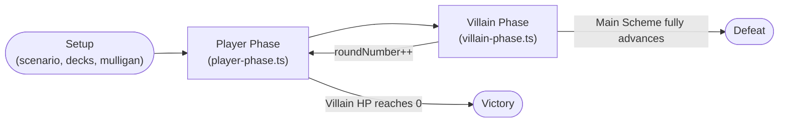

- **Player Phase:** every player takes turns until all have passed. This is where `ACTION`,
  `RESOURCE`, and both `HERO_*`/`ALTER_EGO_*` timings fire.
- **Villain Phase:** a fixed 6-step machine (see [04. Combat & Villain Phase](#combat--villain-phase-sequences))
  where `WHEN_REVEALED`, `BOOST`, and villain/minion activation triggers fire.
- Round-boundary triggers (`ROUND_BEGAN`, `ROUND_ENDED`, `PLAYER_PHASE_BEGAN/ENDED`,
  `VILLAIN_PHASE_BEGAN/ENDED`) are dispatched at the transitions above — see
  [`src/engine/pipeline/round-upkeep.ts`](../../src/engine/pipeline/round-upkeep.ts).

---

### 2. Player Turn — Where Each `timing` Fires

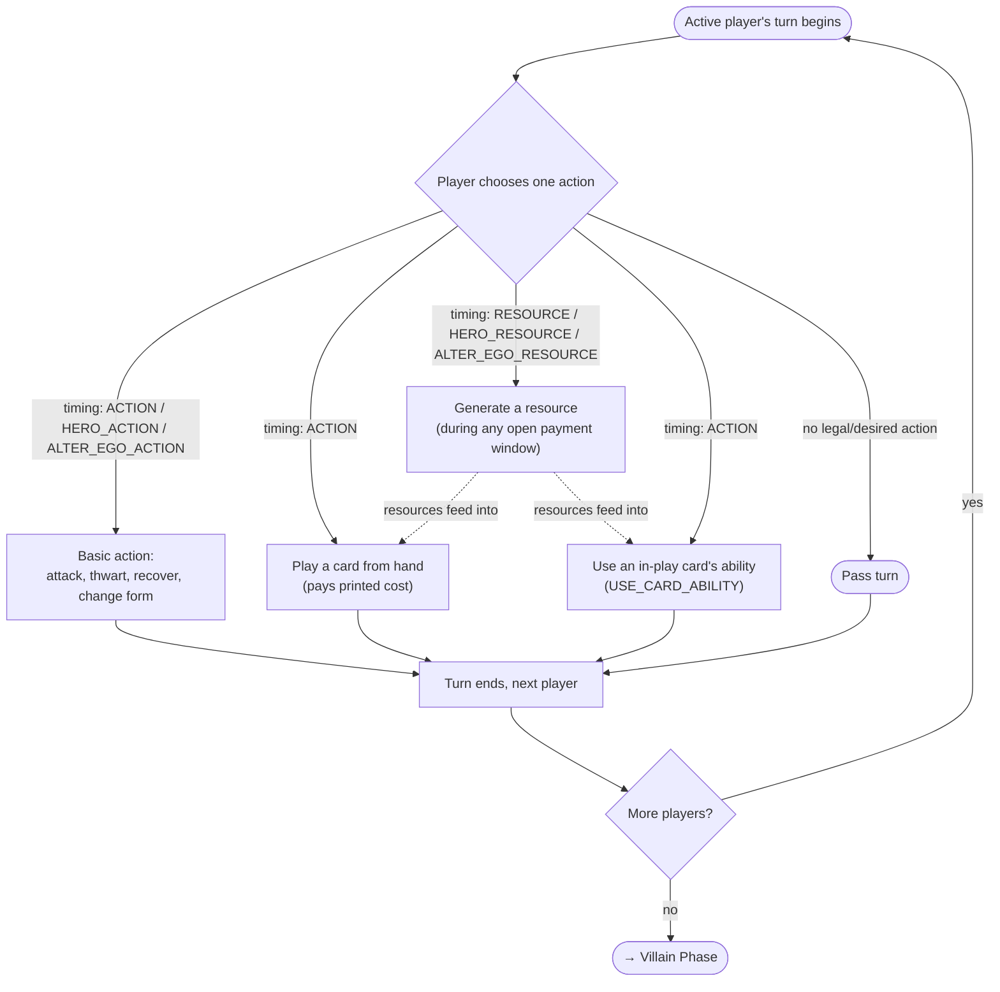

> [!TIP]
> `INTERRUPT` / `RESPONSE` / `FORCED_*` timings are **not** chosen from this menu — they are
> reactions dispatched by the [Trigger Resolution Stack](#trigger-resolution-stack) in
> response to _any_ player or villain-phase event, including the ones drawn above.

---

### 3. Zone Map (Where Targets & Effects Live)

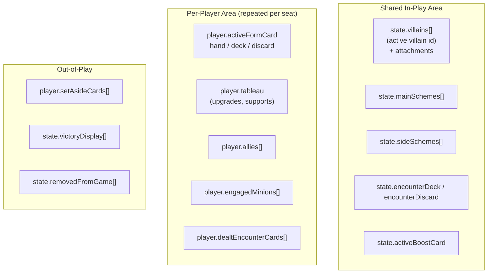

Full field-level detail: [`algorithmic_rules_reference.md §3`](./algorithmic_rules_reference.md#3-formal-play-areas--zones-architecture-rr-v18-p-22-23).

---

## Ability Lifecycle

> Companion to [03. Costs & Targeting](../creators/supplemental-reference/03_costs_and_targeting.md)
> and [10. Sequences & Modals](../creators/supplemental-reference/10_sequences_and_prompts.md).
> This is the diagram to open whenever you're wondering _"in what order does my ability's
> JSON actually get evaluated?"_

---

### 1. From Card JSON to Applied Effect

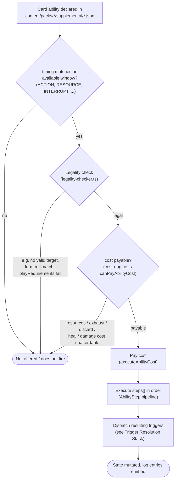

---

### 2. Executing One `steps[]` Array

Each entry in `steps: []` is evaluated independently, in array order, and may reference the
outcome of a previous step via `gate` / `target: "PREVIOUS_TARGET"`.

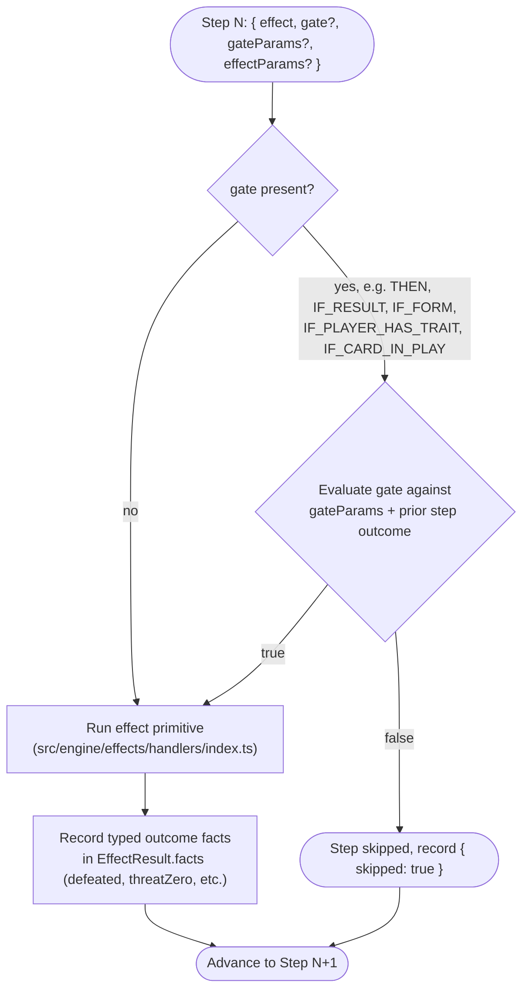

> [!NOTE]
> `gateParams` configures the _gate_ (whether the step runs); `effectParams` configures the
> _effect_ (what the step does) — they are never merged. See
> [ADR-0060](../decisions/0060-gate-and-effect-params-separation.md), or
> [10. Sequences & Modals §1](../creators/supplemental-reference/10_sequences_and_prompts.md#1-unified-action-step-sequencing-steps---conditional-gates).

---

### 3. Interactive Steps: `PLAYER_CHOICE`

When a step's `effect` is `PLAYER_CHOICE`, the pipeline above pauses instead of running
straight through:

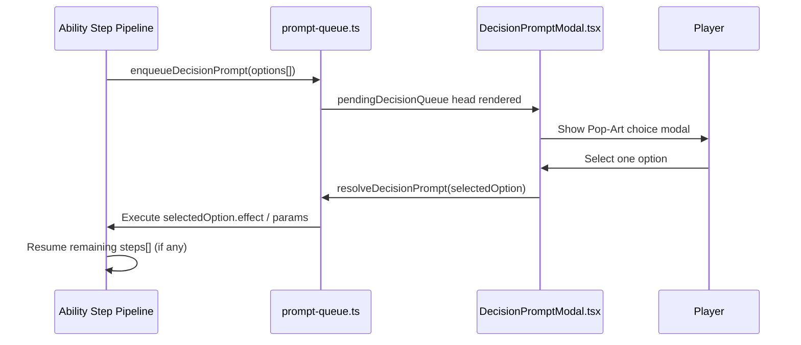

---

## Trigger Resolution Stack

> Companion to [02. Timings & Triggers](../creators/supplemental-reference/02_timings_and_triggers.md)
> and [`algorithmic_rules_reference.md §4`](./algorithmic_rules_reference.md#4-the-7-stage-timing-pipeline--nested-resolution-stack).
> Read this whenever two or more cards could react to the same in-game event.

---

### 1. The 7-Stage Nested Resolution Stack

Every dispatched event (an attack, damage, a card entering play, threat placement, etc.)
passes through this fixed pipeline, implemented conceptually in
[`src/engine/triggers/trigger-dispatcher.ts`](../../src/engine/triggers/trigger-dispatcher.ts):

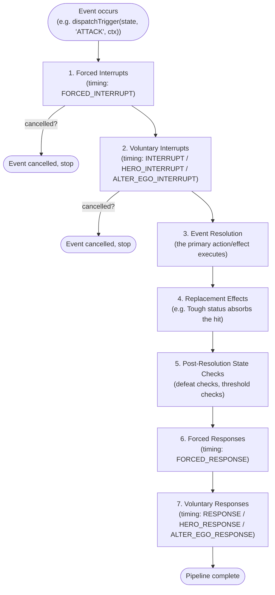

> [!IMPORTANT]
> **Simultaneous ordering:** if multiple abilities are eligible at the _same_ stage, the
> active/first player chooses resolution order (RR v1.8 p. 16). The engine does not guess —
> it prompts.

---

### 2. Matching a Card's `trigger` to a Dispatch Point

A card's `trigger` field (e.g. `'ATTACK'`, `'DAMAGE_WOULD_BE_TAKEN'`, `'CARD_PLAYED'`) selects
_which_ event this ability listens for; its `timing` (`INTERRUPT` vs `RESPONSE` vs
`FORCED_*`) selects _which stage above_ it resolves at.

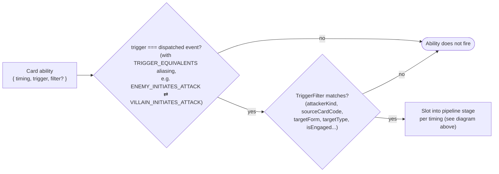

- Full `trigger` catalog and source pipeline mapping:
  [02. Timings & Triggers §2](../creators/supplemental-reference/02_timings_and_triggers.md#2-event-trigger-windows-trigger).
- When a character is defeated, [`trigger-dispatcher.ts`](../../src/engine/triggers/trigger-dispatcher.ts)
  also offers in-hand `CHARACTER_DEFEATED` responses (for example _Chase Them Down_ `01052`);
  an attachment reacts only when its own host is defeated.

---

### 3. Worked Example: Spider-Sense vs. an Incoming Attack

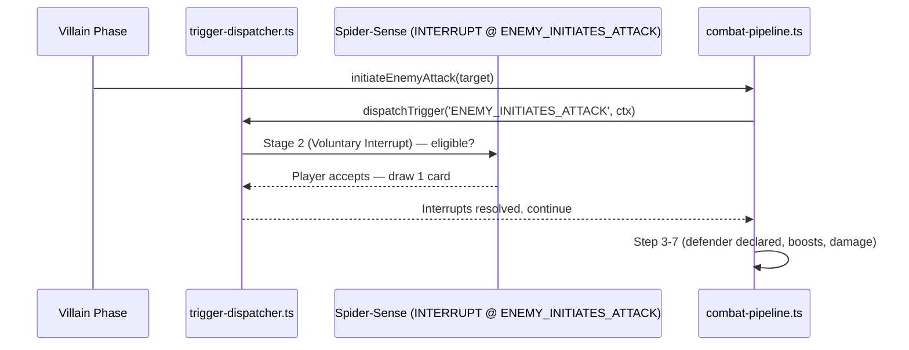

---

## Combat & Villain Phase Sequences

> Companion to [05. Combat & Threat](../creators/supplemental-reference/05_effects_combat_threat.md)
> and [08. Villain & Nemesis](../creators/supplemental-reference/08_effects_villain_nemesis.md).
> Ground truth: [`src/engine/pipeline/combat-pipeline.ts`](../../src/engine/pipeline/combat-pipeline.ts)
> and [`src/engine/pipeline/villain-phase.ts`](../../src/engine/pipeline/villain-phase.ts).

---

### 1. Attack Resolution — `combat-pipeline.ts` Steps 1–7

```mermaid
sequenceDiagram
    participant E as Enemy (Villain/Minion)
    participant CP as combat-pipeline.ts
    participant TD as trigger-dispatcher.ts
    participant D as Defending Player

    CP->>CP: step1_preAttackAndStunCheck<br/>(Webbed Up / Stun intercepts)
    CP->>TD: step2_dispatchInitiationTriggers<br/>(ENEMY_INITIATES_ATTACK — Spider-Sense window)
    CP->>D: step3_openDefenderDeclarationPrompt<br/>(choose defender or take undefended)
    CP->>CP: step4_and_5_dealAndResolveBoostCards<br/>(reveal boost, resolve BOOST)
    CP->>CP: step6_calculateAndApplyAttackDamage<br/>(ATK vs DEF, then the damage pipeline: Tough, Piercing, shields, Overkill)
    CP->>TD: DAMAGE_WOULD_BE_TAKEN window<br/>(pipeline step 3, after Tough: Backflip-style prevention; the Overkill excess has its own)
    CP->>TD: DAMAGE_TAKEN / CHARACTER_DEFEATED (if applicable)
    CP->>CP: step7_resolvePostAttackAndRetaliate<br/>(Retaliate damage back to attacker)
```

| Step | Function                               | Card-author-relevant trigger(s)                                                                                                                                                                |
| :--- | :------------------------------------- | :--------------------------------------------------------------------------------------------------------------------------------------------------------------------------------------------- |
| 1    | `step1_preAttackAndStunCheck`          | `HOST_WOULD_ATTACK` (e.g. Webbed Up)                                                                                                                                                           |
| 2    | `step2_dispatchInitiationTriggers`     | `ENEMY_INITIATES_ATTACK`                                                                                                                                                                       |
| 3    | `step3_openDefenderDeclarationPrompt`  | _(defender is declared; no trigger fires yet)_                                                                                                                                                 |
| 4–5  | `step4_and_5_dealAndResolveBoostCards` | `BOOST`                                                                                                                                                                                        |
| 6    | `step6_calculateAndApplyAttackDamage`  | `DAMAGE_WOULD_BE_TAKEN` (inside the damage pipeline, after Tough), `DAMAGE_TAKEN`, `CHARACTER_DEFEATED`, `DEFEATED`                                                                            |
| 7    | `step7_resolvePostAttackAndRetaliate`  | `ATTACK_DEFENDED` (hero or ally defended; e.g. Counter-Punch, Indomitable), `ATTACK_RESOLVED`, `HOST_ATTACK_ENDED` (attachments on the attacker, after Retaliate; e.g. Charge discards itself) |

---

### 2. The 6-Step Villain Phase

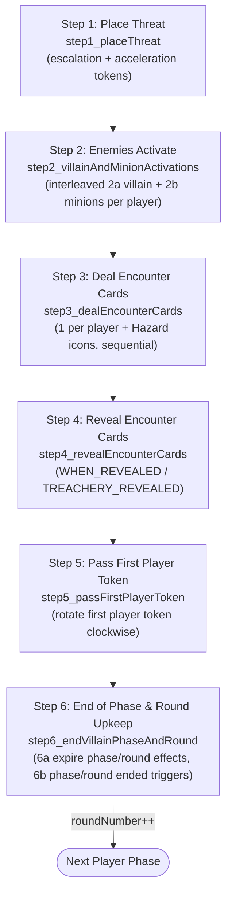

> [!NOTE]
> RR v1.8 p. 47 describes Step 2 as "Enemies Activate" containing an interleaved player-by-player loop
> (2a the villain activates against a player, then 2b each minion engaged with that player activates against them),
> implemented by `step2_villainAndMinionActivations` (aliased as `step2_villainActivations` for backward compatibility).
> Encounter cards are dealt in **Step 3** (`step3_dealEncounterCards`, aliased as `step4_dealEncounterCards`) and
> revealed in **Step 4** (`step4_revealEncounterCards`, aliased as `step5_revealEncounterCards`).
> In **Step 5**, the first player token passes clockwise (`step5_passFirstPlayerToken`).
> In **Step 6** (`step6_endVillainPhaseAndRound`, composite wrapper `step6_passFirstPlayerAndRoundUpkeep`):
>
> - **Step 6a:** Effects lasting until the end of the phase/round expire, and once-per-phase/round limits reset.
> - **Step 6b:** Triggers for `VILLAIN_PHASE_ENDED` and `ROUND_ENDED` resolve in turn order starting with the newly designated first player, followed by round transition to the next Player Phase.
>
> Runtime orchestrator in `continueVillainPhase` (`villain-phase.ts`):
>
> ```ts
> // Step 2: Activations
> if (state.villainPhaseStep === VillainPhaseStep.VILLAIN_ACTIVATIONS) {
>   state = step2_villainAndMinionActivations(state, options);
>   ...
>   state.villainPhaseStep = VillainPhaseStep.DEAL_ENCOUNTER_CARDS;
> }
> // Step 3: Deal Encounter Cards
> if (state.villainPhaseStep === VillainPhaseStep.DEAL_ENCOUNTER_CARDS) {
>   state = step3_dealEncounterCards(state);
>   ...
>   state.villainPhaseStep = VillainPhaseStep.REVEAL_ENCOUNTER_CARDS;
> }
> // Step 4: Reveal Encounter Cards
> if (state.villainPhaseStep === VillainPhaseStep.REVEAL_ENCOUNTER_CARDS) {
>   state = step4_revealEncounterCards(state);
>   ...
> }
> // Step 5 & 6: Pass First Player & Round Upkeep
> state = step5_passFirstPlayerToken(state);
> return step6_endVillainPhaseAndRound(state);
> ```

#### Step 2 detail — per-player interleaving

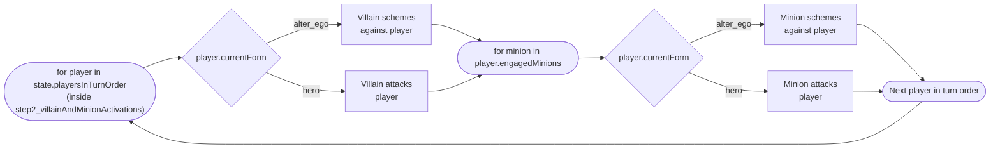

> [!NOTE]
> A `WHEN_REVEALED` ability on an encounter card you're authoring always resolves inside
> **Step 4**, and never earlier — treachery text that reads "when revealed" should never be
> modeled as a `RESPONSE`/`INTERRUPT`.
