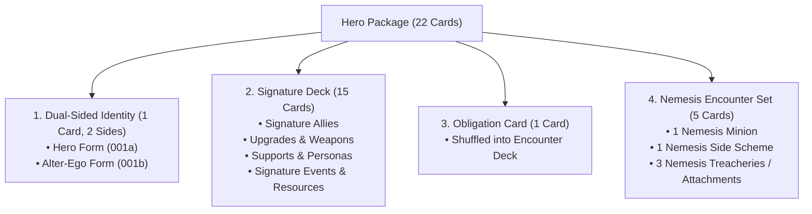
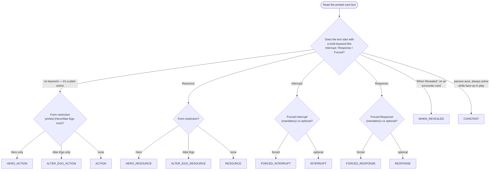
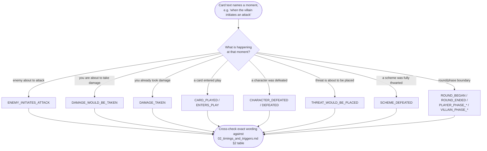
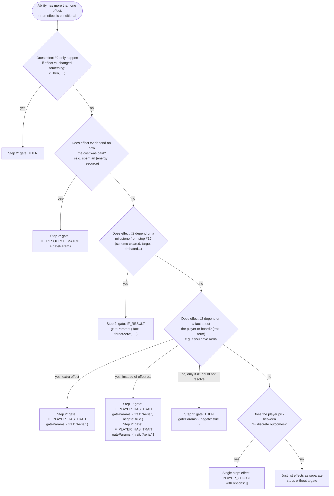

# Hero & Identity Creation Guide

> [!IMPORTANT]
> **Universal Hero Package Standard (ADR-0022 / Mandate #16):**  
> All built-in heroes and community fan-made heroes share the **exact same 22-card package anatomy, supplemental schema, and engine capabilities**.

This guide explains how to design, write, and integrate a custom **Hero Package** into **Marvel Champions Digital**.

---

## 1. The 22-Card Hero Anatomy

Every Hero package consists of exactly **22 cards**:



---

## 2. Upstream Data Format Compliance (zzorba / MarvelCDB Standard)

> [!IMPORTANT]
> **Strict zzorba / MarvelCDB Schema Compliance:**  
> All base card definitions in `content/` **must strictly comply with the upstream zzorba format** ([`zzorba/marvelsdb-json-data`](https://github.com/zzorba/marvelsdb-json-data)), which is the canonical standard used by [MarvelCDB](https://marvelcdb.com).
>
> **Separation of Concerns:**
>
> 1. **Upstream zzorba JSON (`content/`):** Contains static presentation, card text, traits, costs, printed stats, and deckbuilding metadata.
> 2. **Supplemental Rules JSON (`src/data/supplemental/`):** Contains pure engine-executable `abilities` with `steps: AbilityStep[]`, costs, timings, triggers, and audit proofs.

### Standard zzorba Card Fields:

- `code` _(string, required)_: Unique identifier (e.g. `"custom_001a"`).
- `name` _(string, required)_: Card title (e.g. `"Daredevil"`).
- `type_code` _(string, required)_: Canonical type (`"hero"`, `"alter_ego"`, `"ally"`, `"event"`, `"resource"`, `"support"`, `"upgrade"`, `"obligation"`, `"minion"`, `"side_scheme"`, `"treachery"`, `"attachment"`).
- `faction_code` _(string, required)_: Faction (`"hero"`, `"aggression"`, `"justice"`, `"leadership"`, `"protection"`, `"basic"`, `"encounter"`).
- `pack_code` _(string, required)_: Pack identifier (e.g. `"custom"`).
- `set_code` _(string, optional)_: Set grouping (e.g. `"daredevil"`, `"daredevil_nemesis"`).
- `is_unique` _(boolean, optional)_: Whether unique diamond (`◆`) is printed.
- `cost` _(number, optional)_: Resource play cost for player cards.
- `health`, `hand_size`, `thwart`, `attack`, `defense`, `recover` _(number, optional)_: Printed stats.
- `traits` _(string, optional)_: Period-delimited traits (e.g. `"Avenger. Defender."`).
- `text` _(string, optional)_: HTML-formatted card text for presentation (engine never scrapes this).

---

## 3. Step 1: Design the Dual-Sided Identity

The identity consists of two card entries sharing the same base code (`<code>a` for Hero, `<code>b` for Alter-Ego):

### Hero Card (`custom_001a`)

```json
{
  "code": "custom_001a",
  "name": "Daredevil",
  "type_code": "hero",
  "faction_code": "hero",
  "pack_code": "custom",
  "set_code": "daredevil",
  "is_unique": true,
  "health": 11,
  "hand_size": 5,
  "thwart": 2,
  "attack": 2,
  "defense": 2,
  "traits": "Avenger. Defender.",
  "text": "<b>Interrupt</b>: When you defend against an attack, deal 1 damage to the attacking enemy."
}
```

### Alter-Ego Card (`custom_001b`)

```json
{
  "code": "custom_001b",
  "name": "Matt Murdock",
  "type_code": "alter_ego",
  "faction_code": "hero",
  "pack_code": "custom",
  "set_code": "daredevil",
  "is_unique": true,
  "health": 11,
  "hand_size": 6,
  "recover": 3,
  "traits": "Attorney. Civilian.",
  "text": "<b>Action</b>: Exhaust Matt Murdock → remove 1 threat from a scheme."
}
```

### Declarative Supplemental Enrichment (`src/data/supplemental/`)

```json
{
  "custom_001a": {
    "comment": "HERO: Daredevil. Retaliate/Defense trigger.",
    "abilities": [
      {
        "id": "daredevil_defense_interrupt",
        "timing": "INTERRUPT",
        "trigger": "ATTACK",
        "steps": [
          {
            "effect": "DEAL_DAMAGE",
            "params": {
              "amount": 1,
              "target": "CHOSEN_ENEMY"
            }
          }
        ]
      }
    ],
    "audit": {
      "createdAt": "2026-08-30T15:00",
      "updatedAt": "2026-08-30T15:00",
      "reviewedAt": "2026-08-30T15:00",
      "reviewedBy": "creator",
      "rulesVersion": "v1.8",
      "confidence": 98,
      "originalText": "Interrupt: When Daredevil defends against an attack, deal 1 damage to the attacker."
    }
  },
  "custom_001b": {
    "comment": "ALTER-EGO: Matt Murdock. Exhaust to remove 1 threat.",
    "abilities": [
      {
        "id": "matt_murdock_action",
        "timing": "ALTER_EGO_ACTION",
        "cost": {
          "exhaustSelf": true
        },
        "steps": [
          {
            "effect": "REMOVE_THREAT",
            "params": {
              "amount": 1,
              "target": "CHOSEN_SCHEME"
            }
          }
        ]
      }
    ],
    "audit": {
      "createdAt": "2026-08-30T15:00",
      "updatedAt": "2026-08-30T15:00",
      "reviewedAt": "2026-08-30T15:00",
      "reviewedBy": "creator",
      "rulesVersion": "v1.8",
      "confidence": 98,
      "originalText": "Action: Exhaust Matt Murdock -> remove 1 threat from a scheme."
    }
  }
}
```

---

## 3. Step 2: Assemble the 15-Card Signature Deck

A hero's 15 signature cards must all have `set_code` matching the hero (`"daredevil"`):

| Card Type               | Typical Count | Purpose                                   | Example                        |
| :---------------------- | :------------ | :---------------------------------------- | :----------------------------- |
| **Signature Ally**      | 1             | Hero's iconic sidekick / partner.         | _Elektra_ or _Foggy Nelson_    |
| **Signature Upgrades**  | 2–4           | Weapons, armor, suits, and combat tech.   | _Billy Club_, _Baton_          |
| **Signature Supports**  | 1–2           | Base of operations, personas, vehicles.   | _Nelson & Murdock Law Office_  |
| **Signature Events**    | 6–9           | Signature Attacks, Thwarts, and Defenses. | _Blind Justice_, _Radar Sense_ |
| **Signature Resources** | 1–2           | Triple or double wild resources.          | _Heightened Senses_            |

### Example: Signature Upgrade (_Billy Club_)

```json
{
  "code": "custom_002",
  "name": "Billy Club",
  "type_code": "upgrade",
  "cost": 2,
  "set_code": "daredevil",
  "traits": "Weapon.",
  "text": "<b>Hero Action</b>: Exhaust Billy Club → choose: deal 2 damage to an enemy, or stun an enemy."
}
```

---

## 4. Step 3: Author the Obligation Card

Every hero requires exactly 1 obligation card shuffled into the encounter deck during Step 5 of Game Setup:

```json
{
  "code": "custom_016",
  "name": "Pro Bono Case",
  "type_code": "obligation",
  "set_code": "daredevil",
  "text": "<b><i>Give to the Matt Murdock player.</i></b>\nYou may flip to alter-ego form. Choose:\n• Exhaust Matt Murdock → remove Pro Bono Case from the game.\n• Discard 2 random cards from your hand. Discard this obligation."
}
```

---

## 5. Step 4: Create the 5-Card Nemesis Encounter Set

The Nemesis encounter set provides the nemesis cards set aside at the start of the game:

1. **Nemesis Minion (1 card):** Unique minion entering play engaged with the hero (e.g. _Bullseye_, 4 HP, 2 SCH, 2 ATK, `Quickstrike`).
2. **Nemesis Side Scheme (1 card):** Enters play with base threat (e.g. _Target in Sight_, 3 base threat per player, Hazard icon).
3. **Nemesis Treacheries / Attachments (3 cards):** Thematic hazards shuffled into the encounter deck by _Shadow of the Past_ (`01190`).

### Example: Nemesis Minion (_Bullseye_)

```json
{
  "code": "custom_017",
  "name": "Bullseye",
  "type_code": "minion",
  "faction_code": "encounter",
  "set_code": "daredevil_nemesis",
  "is_unique": true,
  "health": 5,
  "scheme": 1,
  "attack": 2,
  "traits": "Assassin. Criminal.",
  "text": "Quickstrike. <b>Forced Response</b>: After Bullseye attacks you, deal 1 damage to your hero."
}
```

---

## 6. Step 5: Verify & Test

Write an automated test suite in `tests/engine/` testing your custom hero:

```typescript
import { describe, it, expect } from 'vitest';
import { cardCatalog } from '@data/card-loader';
import { setupGame } from '@engine/state/game-setup';
import { dispatchAction } from '@engine/pipeline';

describe('Custom Hero: Daredevil', () => {
  it('Initializes Daredevil with full 15-card deck and set-aside nemesis cards', () => {
    const hero = cardCatalog.getCard('custom_001a') as any;
    const alterEgo = cardCatalog.getCard('custom_001b') as any;

    const state = setupGame({
      scenarioId: 'rhino',
      players: [
        {
          id: 'p1',
          name: 'Player 1',
          hero,
          alterEgo,
          deckCards: Array(15).fill(cardCatalog.getCard('custom_002')!),
        },
      ],
      villain: cardCatalog.getCard('01094') as any,
      mainScheme: cardCatalog.getCard('01097b') as any,
      encounterCards: cardCatalog.getCardsBySet('rhino'),
    });

    expect(state.players[0].setAsideCards.length).toBe(5);
    expect(state.players[0].health).toBe(11);
  });
});
```

### Run Schema Validation & Declarations Audit

After adding cards and writing tests, execute:

```bash
npm run report:declarations   # Regenerates docs/reports/supplemental_declarations_usage_report.md
npm test                      # Runs Vitest test suite including supplemental-schema.test.ts
npm run typecheck             # Verifies TypeScript types
```

---

## 7. Related References

- [Supplemental Data Schema Specification](../specifications/supplemental/README.md)
- [Scenario Creation Guide](./scenario_creation_guide.md)
- [Card Integration Protocol (SKILL.md)](../../.agents/skills/card-integration-protocol/SKILL.md)

---

## Appendix: Which `timing`, `trigger` and `effect` do I pick?

> This appendix has no direct 1:1 spec equivalent: it's a practical
> decision tree for turning printed card text into a first-draft supplemental JSON entry.
> Always finish by checking your draft against the linked spec module before submitting.

---

### 1. "What `timing` do I use?"



Full enum reference: [02. Timings & Triggers §1](../specifications/supplemental/02_timings_and_triggers.md#1-ability-timing-types-timing).

---

### 2. "What `trigger` does my Interrupt/Response bind to?"



If your event isn't listed, check the `TriggerTypeSchema` enum in
[`schema-primitives.ts`](../../src/data/supplemental/schema-primitives.ts) for an existing trigger
before proposing a new trigger literal (new literals require an engine change, not just
supplemental data — see [feature-delivery skill](../../.agents/skills/feature-delivery/SKILL.md)).

---

### 3. "Do I need `steps: []`, `gate`, or `condition`?"



Worked examples (additive `IF_PLAYER_HAS_TRAIT` on Crisis Interdiction `01012`, exclusive `IF_PLAYER_HAS_TRAIT` with `negate` on Mark V Helmet `01037`, `THEN` fallback with `negate`) and when each applies:
[10. Sequences & Modals, Gating Patterns](../specifications/supplemental/10_sequences_and_prompts.md#gating-patterns-then-if_result-and-if_player_has_trait).

Full gate catalog:
[10. Sequences & Modals §1](../specifications/supplemental/10_sequences_and_prompts.md#conditional-gates-adr-0080).

---

### 4. Draft-to-Submission Checklist

1. Pick `timing` → §1 above.
2. Pick `trigger` (if reactive) → §2 above.
3. Pick effect primitive(s) from
   [05](../specifications/supplemental/05_effects_combat_threat.md)–[08](../specifications/supplemental/08_effects_villain_nemesis.md)
   by category (combat, zones, status/economy, villain/nemesis).
4. Sequence multi-effect abilities with `steps: []`, `gate`/`condition` → §3 above.
5. Add `cost` ([03. Costs & Targeting](../specifications/supplemental/03_costs_and_targeting.md))
   and `playRequirements` ([11. Play Requirements](../specifications/supplemental/11_play_requirements.md))
   if the card restricts who/when it can be used.
6. Validate against [`tests/data/supplemental-schema.test.ts`](../../tests/data/supplemental-schema.test.ts)
   and follow the [Card Integration Protocol](../../.agents/skills/card-integration-protocol/SKILL.md)
   for ambiguity handling.
