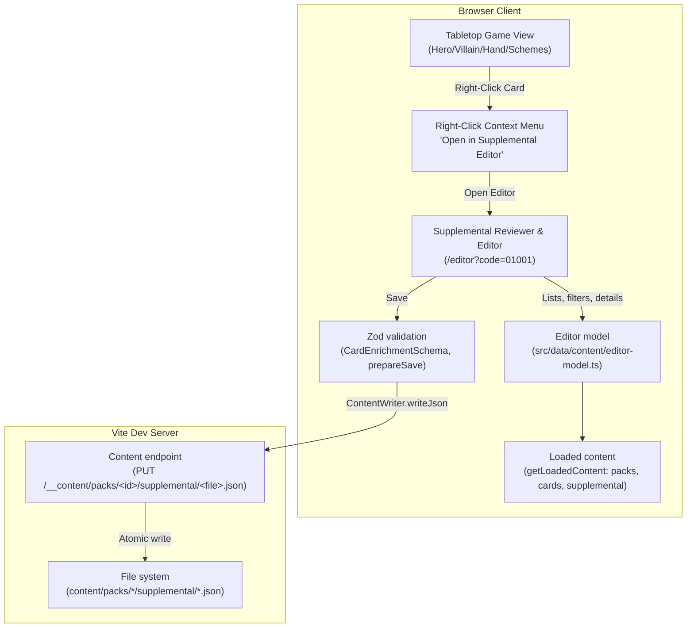

# Specification: Card Supplemental Editor & Live Reviewer GUI

- **Status:** 🟢 IMPLEMENTED / SPECIFIED
- **Related ADR:** [ADR-0045](../../decisions/0045-card-supplemental-editor-and-live-reviewer-gui.md)
- **Author:** MCD Core Team
- **Date:** 2026-09-05

---

## 1. Overview & Objectives

The **Card Supplemental Editor & Live Reviewer GUI** is an integrated developer tool that streamlines reviewing, verifying, and enriching card supplemental data (`content/packs/*/supplemental/*.json`) directly within the Marvel Champions Digital web application.

### Key Objectives

1. **Multi-Criteria Discovery:** Filter and search cards across all 170+ official Zzorba packs, encounter sets, hero identities, and aspect affinities.
2. **Dual-Inspector Reviewer:** Compare printed card art and text alongside raw upstream attributes and declarative supplemental rules in real time.
3. **Live Schema Validation:** Enforce strict adherence to `CardEnrichmentSchema` ([ADR-0043](../../decisions/0043-codebase-grounded-supplemental-schema-validation-and-live-vscode-integration.md)), reporting line-level errors for invalid effect primitives, parameters, or timings.
4. **Local REST Persistence:** Save modifications directly to disk via Vite dev middleware, updating pack JSON files and stamping audit records automatically.
5. **In-Game Tabletop Inspection:** Right-click any card on the tabletop during gameplay to jump directly to its supplemental definition in a new tab.
6. **Live Reloading:** Hot-reload card rules in the application upon saving.

---

## 2. Architecture & Data Flow

The editor has no API of its own (M9, Q24 as amended by Q57). It reads the content the game already loaded, and writes through the storage side of the content endpoint.



Saved data reaches the running game after a page reload; the editor's own list and inspector update at once because the loaded pack is updated in memory.

---

## 3. Reading, Saving and the Write Rule

### 3.1. Reading

`src/data/content/editor-model.ts` builds everything the screens show from `LoadedContent` plus `content/meta/{packs,sets,factions}.json`: the pack selector (`editorPacks`: id, name, origin, `writable`), card summaries with filters (`packId`, `packFile`, `pack`, `set`, `faction`, `hero`, `status`, `search`) and paging, and card details with validation. Only enabled packs are loaded, so only they appear; enable a pack in `content/config.json` to edit it.

### 3.2. Saving

`saveCardSupplemental` (`src/ui/services/supplemental-editor-service.ts`) runs `prepareSave`, which:

1. refuses a card of a pack that is not writable;
2. resolves the target file: `payload.packFile`, else `<stem>.json` of the card file the card comes from, inside `packs/<id>/supplemental/`. The name must match `^[a-z0-9_-]+\.json$` (`isPackFileName`);
3. applies the event invariant (`findEventDiscardSelfViolations`) and `CardEnrichmentSchema.safeParse`, returning the Zod errors when invalid;
4. stamps `audit.updatedAt`/`reviewedAt` (`YYYY-MM-DDTHH:MM:SSZ`), `reviewedBy` and `rulesVersion`.

The service then re-reads the target file, sets `cards[code]` and writes the whole file with `ContentWriter.writeJson` (`FetchDriver` sends `PUT /__content/<path>`).

### 3.3. The one write route

`PUT /__content/packs/<id>/supplemental/<file>.json` in `src/tools/content-middleware.ts` (`handleContentWrite`). It exists on the dev server only (`vite preview` registers the read-only endpoint). It refuses with HTTP 403 any other path, and a pack whose `pack.json` origin is not `user` or `official-bundled` (`official-sync` packs are re-downloaded, so edits would be lost). It answers 400 for a body that is not valid JSON or fails `SupplementalPackSchema`, and writes through a temp file and a rename. Editing Core therefore changes tracked files in the working tree, visible in `git status`.

---

## 4. User Interface & Layout Specifications

The Supplemental Editor UI adheres strictly to the **1960s Comic Pop-Art Theme** ([ADR-0004](../../decisions/0004-visual-art-direction-comic-pop-art.md)):

- Bold heavy black comic borders (`border-3 border-black shadow-comic-pop`).
- Dynamic Ben-Day halftone dot backgrounds.
- Bangers headings and high-contrast typography.
- Status badges: 🟢 Green (100% Verified), 🟡 Yellow (Partial / Draft), 🔴 Red (Schema Error / Missing).

### 4.1. Workspace Layout

The Editor is organized into a 3-column split view with responsive real estate controls:

```
+---------------------------------------------------------------------------------------------------+
| TOP BAR: [MCD Card Supplemental Reviewer] [Sidebar Toggle] | Presets | [Save Card] [Hot Reload]    |
+------------------------------------+--------------------------+-----------------------------------+
| LEFT: FILTER & CARD LIST (320-384px| CENTER: INSPECTOR (320px)| RIGHT: SUPPLEMENTAL BUILDER       |
| (Collapsible: reclaim 100% width)  | (Fitted Card Width)      | (Flex-1: fills remaining width)   |
| - Pack: [Core Set          v]      | [CardView Visual Preview]| [Form View] | [Raw JSON View]     |
| - Set:  [All Sets          v]      |                          |                                   |
| - Faction: [All Factions   v]      | ------------------------ | Abilities Tree:                   |
| - Search: [spider...       ]       | Printed Text:            | [+] Add Ability (High-Contrast)   |
| ---------------------------------- | "Interrupt: When..."     | ├─ Timing: [HERO_INTERRUPT v]     |
| Cards (101):                       |                          | ├─ Trigger: [ENEMY_INIT...]       |
| > 01001a Spider-Man        [100%]  | Upstream Zzorba Meta     | ├─ Cost: [Exhaust: Yes]           |
|   01001b Peter Parker      [100%]  | (2-Column Grid):         | └─ Steps (1):                     |
|   01002  Spider-Tracer     [100%]  | - Traits: Avenger        |    └─ Primitive: [DRAW]           |
|   01003  Web-Shooter       [100%]  | - Type: Hero             |       EffectParams: { count: 1 }  |
|   01004  Backflip          [100%]  | - Hand Size: 5           |                                   |
|                                    | - HP: 10                 | Live Zod Diagnostics: (0 err)     |
+------------------------------------+--------------------------+-----------------------------------+
```

- **Collapsible Column 1:** Can be toggled open/closed via header or sidebar divider controls, expanding the inspection and rules editing view across the full display.
- **Natural-Width Column 2:** Constrained to natural card width (`w-full md:w-[320px] lg:w-[340px] shrink-0 border-r-4 border-black`), displaying Upstream Zzorba Properties in a clean 2-column grid (`grid-cols-2`).
- **Expanded Column 3:** Occupies all remaining screen real estate (`flex-1 w-full overflow-y-auto`), allowing comfortable editing of multi-step ability pipelines, nested universal card filters, and dynamic value builders.
- **Design System Palette & Contrast:** Uses canonical Comic Blue (`#0284C7` / `comic.accent`) for buttons, active chips, and mode selectors with high-contrast white text, solid black borders, and Ben-Day box shadows (`shadow-comic-xs`, `shadow-comic-md`, `shadow-comic-pop`).

### 4.2. Dual-Mode Supplemental Builder (Form vs. Raw JSON)

1. **Form Builder Mode:**
   - Dropdown selectors for `timing` (`TimingTypeSchema`), `trigger` (`TriggerTypeSchema`), and `effect` primitives.
   - Dynamic parameter fields based on selected effect primitive (e.g. `amount`, `target`, `gate`, `duration`). Includes specialized controls for domain-separated interception primitives: `PREVENT_DAMAGE` for combat/effect damage to characters, `PREVENT_THREAT` ([ADR-0063](../../decisions/0063-deconflate-damage-and-threat-interception-primitives.md)) for scheme threat prevention with dynamic scalar binding and default `MAIN_SCHEME` targeting, and `DISTRIBUTE_AMOUNT` ([ADR-0064](../../decisions/0064-canonical-target-scopes-and-interactive-distribution-modal.md)) for multi-target pool allocation across damage, threat removal, healing, counters, and exhaustion with interactive distribution modal delegation.
   - Trigger Filter Builder (`TriggerFilterSection`) with interactive sub-forms for `attackerCardFilter` and `cardFilter` (`UniversalCardFilterBuilder`, Issue #287), allowing visual configuration of triggering card criteria (types, traits, keywords) on any trigger event.
   - Audit trail metadata fields (`confidence`, `reviewedBy`, `originalText`, `comment`).
2. **Raw JSON Mode:**
   - Embedded interactive JSON editor with syntax highlighting and live error underlines.
   - Real-time Zod validation badges indicating exact JSONPath error locations.

---

## 5. In-Game Context Menu Integration

Every card rendered on the active game board attaches a custom `onContextMenu` handler with portal-mounted rendering:

1. **Trigger:** Right-clicking any `<CardView />` on the board (Player Hand, Tableau, Villain Zone, Main Scheme, Side Schemes, Attachment, Discard pile preview).
2. **Portal Rendering & Auto-Zoom Immunity:**
   - Mounted directly into `document.body` via `ReactDOM.createPortal` with elevated layering (`z-[9999]`).
   - Completely decoupled from tabletop card CSS transforms (`rotate-0`, `scale-[...]`, `-translate-y-4`) and hover-zoom transitions, ensuring exact fixed viewport coordinate positioning (`e.clientX`, `e.clientY`).
3. **Context Menu Options:**
   - 🔍 **"Open in Supplemental Editor"**: Opens the standalone editor focused on the card in a new browser tab (`window.open('/editor?code=...', '_blank')`).
   - 📋 **"Copy Card Code"**: Copies the card's unique code (`01001a`) directly to the system clipboard.
   - ℹ️ **"View Raw Card Attributes"**: Opens an interactive modal viewer (`z-[10000]`) displaying formatted JSON of upstream and enrichment data with native drag text selection (`select-text`, `cursor-text`) and a 1-click **"Copy JSON"** button.
4. **Game Continuity Invariant:** The current game state remains active in its original tab. Saving modified supplemental data in the editor tab triggers Vite HMR and hot-reloads card definitions.

---

## 6. Acceptance & Contract Criteria

1. **Catalog Completeness:** Filter controls can discover and list all cards across upstream `content/packs/*/cards/*.json`.
2. **Dual-View Fidelity:** The center inspector accurately renders card artwork via `CardView` and displays raw upstream text matching the physical card.
3. **Live Zod Validation:** Attempting to save invalid effect primitives (e.g. `INVALID_PRIMITIVE`) or malformed parameters is blocked in the UI with red error markers.
4. **Atomic Disk Persistence:** Clicking "Save" updates the corresponding pack JSON file with clean 2-space indentation and auto-stamped audit metadata (`updatedAt`, `reviewedBy`).
5. **Right-Click Context Menu:** Right-clicking any card on the tabletop in an active game opens the editor in a new tab focused on that card.
